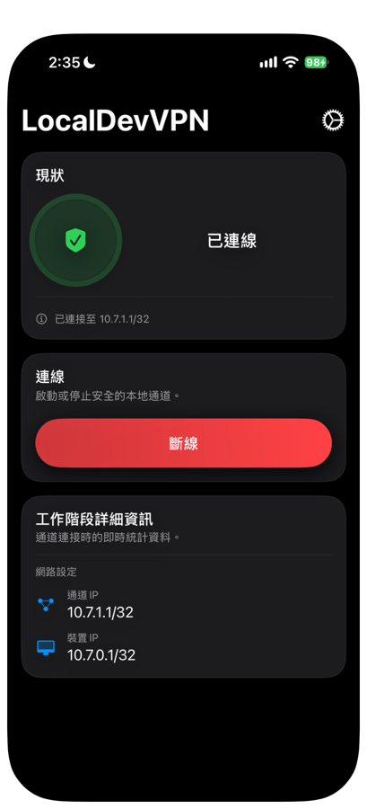
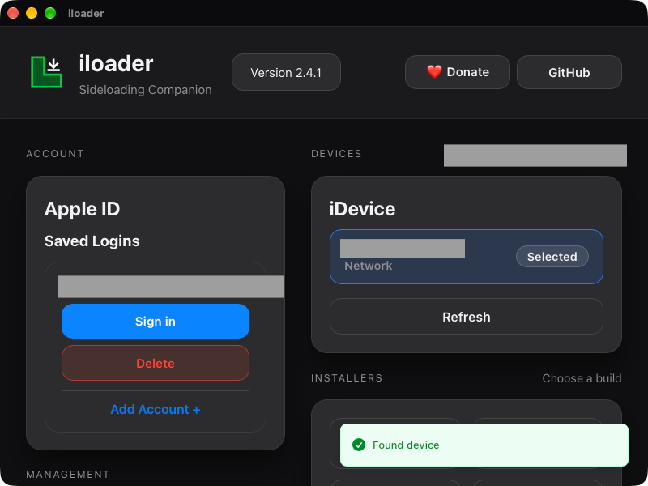
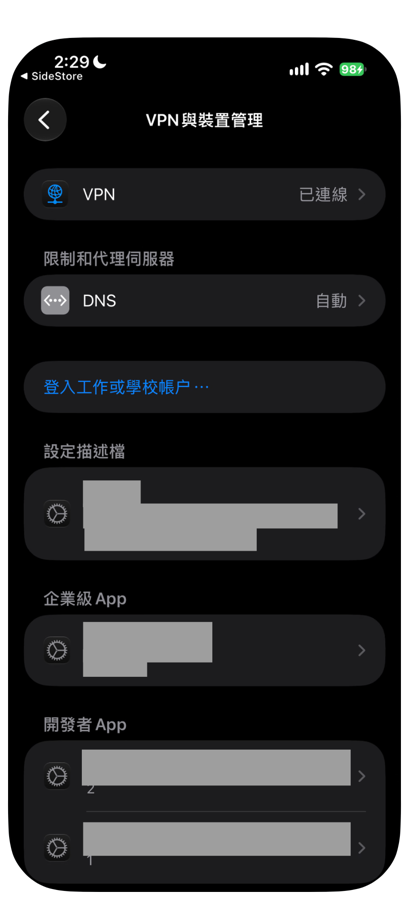

# 02 安裝 SideStore

SideStore 是讓 iPhone 安裝 App Store 以外 App 的工具。本章用你自己的免費 Apple 帳號，把 SideStore 裝進 iPhone。

開始前請先確認 iPhone 與 Mac 都連上 Wi-Fi，並準備好 USB 線。官方說明見 [SideStore 官方網站](https://sidestore.io/)、[安裝需求](https://docs.sidestore.io/docs/installation/prerequisites)與[安裝步驟](https://docs.sidestore.io/docs/installation/install)。

## 一、安裝 LocalDevVPN

LocalDevVPN 在 iPhone 內建立一條本機通道，讓 SideStore 可以在沒有電腦的情況下簽署與續簽 App。

1. 在 iPhone 的 App Store 搜尋並安裝 **LocalDevVPN**。
2. 打開 LocalDevVPN，按下連線按鈕（英文介面為 Connect）。
3. iOS 詢問是否加入 VPN 設定時，按「允許」，並依提示輸入 iPhone 密碼。

成功時，LocalDevVPN 的現狀顯示「已連線」，下方的按鈕變成「斷線」。

## 二、在 Mac 安裝 iloader

iloader 是在電腦上把 SideStore 裝進 iPhone 的工具，只在首次安裝時使用。

1. 在 Mac 開啟 [SideStore 官方網站](https://sidestore.io/)，依官方連結下載 **iloader**，並放進「應用程式」。
2. 用 USB 線連接 iPhone 與 Mac。
3. 在 iPhone 出現「信任這部電腦？」時，按「信任」並輸入密碼。
4. 在 Mac 打開 iloader。

## 三、用 iloader 安裝 SideStore

1. 在 iloader 左側的 **Apple ID** 區塊，按 **Add Account +**，輸入你的 Apple 帳號與密碼。帳號有分大小寫。已經登入過的帳號會列在 **Saved Logins**，按 **Sign in** 即可。
2. 如果出現雙重驗證，輸入 Apple 裝置收到的驗證碼。
3. 在右側的 **iDevice** 區塊確認列出你的 iPhone，並顯示 **Selected**。沒有出現時，按 **Refresh**。
4. 在下方的 **Installers** 區塊，選擇 **Stable SideStore** 安裝。
5. 等待 iloader 完成。

成功時，iloader 顯示完成訊息，iPhone 主畫面出現 SideStore 圖示。登入時如果在 Apple 帳號的裝置清單裡多出一部 Mac，那是登入過程自動產生的虛擬裝置，不需要處理。

## 四、信任開發者

沒有信任開發者之前，SideStore 打不開。

1. 在 iPhone 打開「設定 > 一般 > VPN 與裝置管理」。
2. 在「開發者 App」下選擇你的 Apple 帳號。
3. 按「信任」。iOS 18 以上要選「允許並重新啟動」，再輸入密碼。

完成後，SideStore 可以正常打開，不會再出現「未受信任的開發者」的提示。

## 五、開啟開發者模式

如果 iOS 要求開啟開發者模式：

1. 打開「設定 > 隱私權與安全性」。
2. 捲到最下方，開啟「開發者模式」。
3. iPhone 會重新啟動。重新啟動後出現確認視窗時，選擇開啟並輸入密碼。

沒有看到「開發者模式」選項時，這一步可以略過。

## 六、連上 LocalDevVPN 並登入 SideStore

1. 確認 iPhone 連上 Wi-Fi。
2. 打開 LocalDevVPN，確認顯示「已連線」；沒有連線時按連線按鈕。
3. 打開 SideStore。
4. 用 iloader 登入的同一個 Apple 帳號登入 SideStore。

如果出現「This action cannot be completed at this time. (-80045)」，請先照下一節處理，再重新登入。

### 登入出現 -80045

這是 SideStore 目前已知的問題，與密碼無關。在 SideStore 的 **Settings** 依序操作：

1. 在 **User Customizations**，關閉 **On-Device Anisette**。詢問是否重新啟動時，選是。
2. 在 **Anisette Servers**，選 **SideStore (New)**，再捲到最下方關閉 **Enable Auto Rotation**。
3. 回到 **User Customizations > Anisette Client Configuration > Remote Server Sync**，按 **Fetch**，再按 **Save as Overrides**。
4. 回到 **User Customizations**，按 **Reset adi.pb**。
5. 完全關閉 SideStore，再重新打開並登入。登入可能要等一會兒。

如果仍然失敗，第 2 步改選 **Jkcoxson**，再做一次第 3 至 5 步。不要連續嘗試太多次，Apple 可能暫時限制登入。

成功時，SideStore 進入主畫面，底部有 News、Sources、Browse、My Apps、Settings 五個分頁。

## 七、第一次續簽

1. 在 SideStore 底部打開 **My Apps**。
2. 在 SideStore 旁邊按「7 DAYS」進行 Refresh。
3. 如果詢問是否撤銷或建立新憑證，按 **Yes** 或 **Refresh Now**。

成功時，iPhone 回到主畫面並顯示通知，幾秒後 SideStore 可以再次使用。My Apps 的清單會顯示剩餘的 App ID 數量，例如「5 App IDs Remaining」。**請先完成這次續簽，再安裝其他 App。**

如果 iOS 版本是 26.4 以上，且 Stable 版無法續簽，並出現錯誤 (27)，請告訴開發者你的 iOS 版本。

下一章：[03 安裝 iPhone App](03-install-iphone-app.md)

遇到錯誤碼時，請查看 [10 疑難排解](10-troubleshooting.md)。
