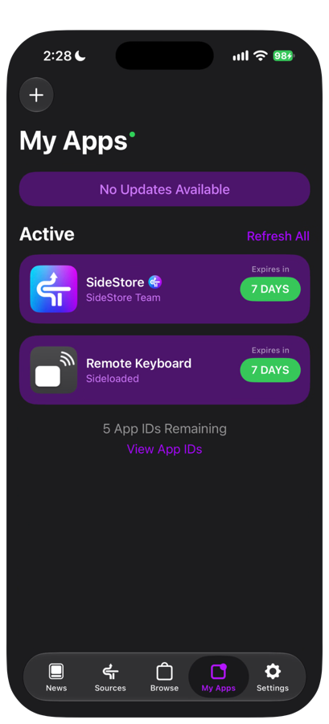
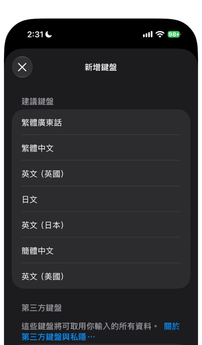
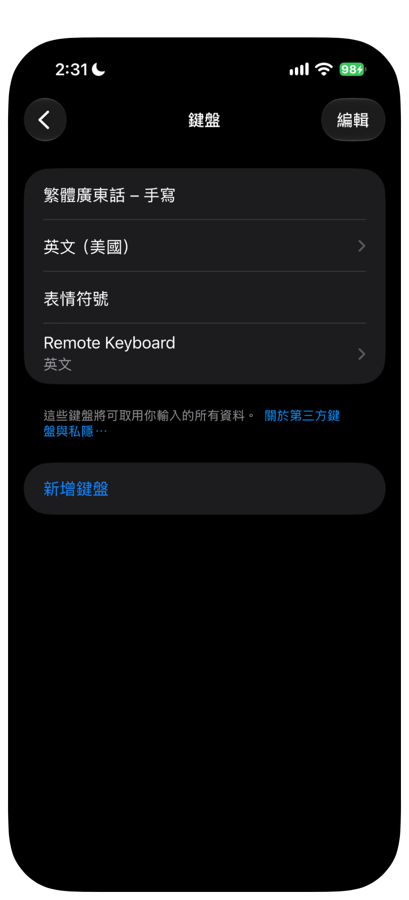
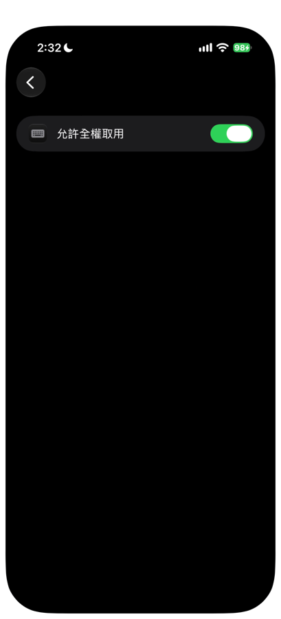
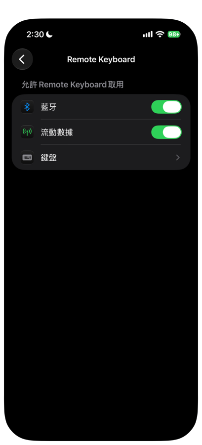
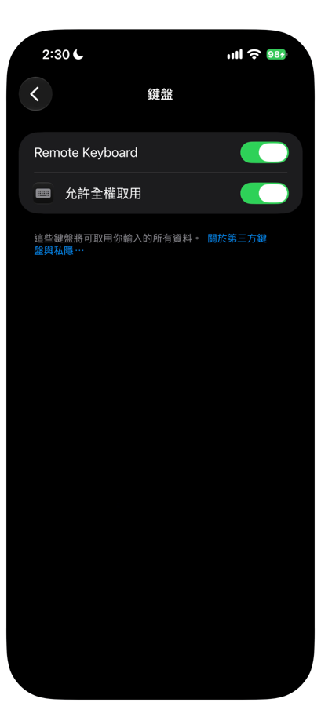
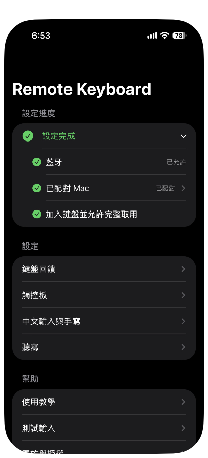
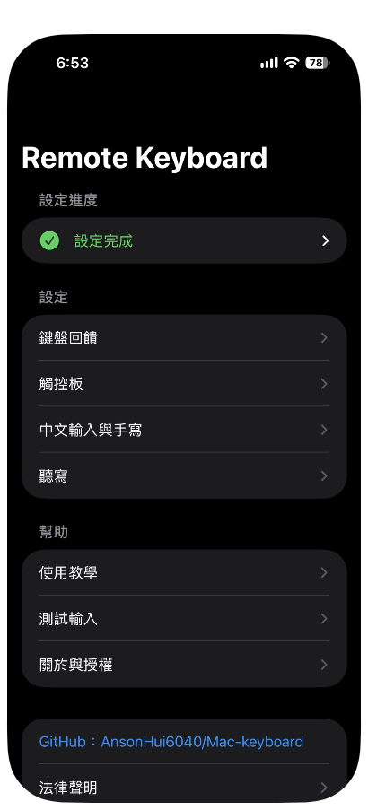

# 03 安裝 iPhone App

本章用 SideStore 把 Remote Keyboard 安裝到 iPhone，加入鍵盤，並開啟需要的權限。

開始前請確認 SideStore 已完成第一次續簽（見 [02 安裝 SideStore](02-install-sidestore.md)），並且 iPhone 連上 Wi-Fi，LocalDevVPN 顯示「已連線」。

## 一、取得並驗證 IPA

1. 在 Mac 下載開發者提供的 `RemoteKeyboard-v版本號-unsigned.ipa`，同時取得對應的 SHA-256 值。
2. 在 Mac 的「終端機」執行下面的指令，把檔案路徑換成你的 IPA 位置。

```bash
shasum -a 256 RemoteKeyboard-v版本號-unsigned.ipa
```

3. 比對輸出的值與開發者提供的 SHA-256，兩者必須完全相同。
4. 用 AirDrop 把同一個 IPA 傳到 iPhone，存到「檔案」App。之後匯入的就是這個已核對過的檔案。

值不同時，請重新下載；重新下載後仍然不同，請回報開發者，不要安裝。

## 二、匯入 IPA

1. 打開 SideStore，進入 **My Apps**。
2. 按左上角的「+」。
3. 在檔案選擇畫面，選擇剛才存好的 IPA。
4. SideStore 詢問如何處理 App Extension 時，選「Keep App Extensions (Register App ID for Each Extension)」。

**不要選 Remove。** 移除 Extension 之後，App 裡就沒有鍵盤了。保留 Extension 會多用 1 個 App ID，所以一次全新安裝共用掉 2 個。

5. 等待安裝完成。



成功時，My Apps 的 Active 清單出現 **Remote Keyboard**，到期欄顯示「7 DAYS」。清單下方會顯示剩餘的 App ID 數量。

## 三、加入鍵盤

1. 打開「設定 > 一般 > 鍵盤 > 鍵盤」。
2. 按「新增鍵盤」。
3. 在「第三方鍵盤」區找到 **Remote Keyboard**，按一下。



4. 回到「鍵盤」頁面，確認清單裡有 Remote Keyboard。
5. 按一下 **Remote Keyboard** 這一列。



沒有看到 Remote Keyboard 時，可能是安裝時移除了 Extension。請重新安裝 IPA，並在詢問 Extension 時選「Keep App Extensions (Register App ID for Each Extension)」。

## 四、允許完整取用

遠端打字、手寫，以及自訂的按鍵聲音與震動，都需要「允許完整取用」。

1. 在上一步開啟的 Remote Keyboard 頁面，開啟「允許完整取用」。部分地區的 iOS 顯示為「允許全權取用」，意思相同。
2. 如果出現警告視窗，閱讀後按「允許」。



也可以從「設定」App 的最下方找到 **Remote Keyboard**，進入後再按「鍵盤」，同樣可以開啟。





成功時，兩個開關都是綠色。

只有在信任這個版本的來源時，才開啟完整取用。隱私說明列出了這項權限的用途，見 [隱私說明](../distribution/privacy-note.md)。

## 五、打開 App 並允許藍牙

1. 在主畫面打開 **Remote Keyboard**。
2. 第一次打開會出現四頁的使用引導，依序是這個 App 做什麼、在 Mac 安裝 Receiver、開啟權限與加入鍵盤、配對 Mac。可以按右上角的「略過」，或一頁一頁按「下一步」，最後按「完成」。
3. 進入主畫面後，在最上方的「設定進度」按「藍牙」，再按「允許藍牙」。
4. iOS 詢問是否允許 Remote Keyboard 使用藍牙時，按「允許」。



成功時，「藍牙」那一列打勾。如果顯示「已拒絕，請到設定開啟」，按「到設定開啟藍牙」，在設定裡開啟藍牙。

「加入鍵盤並允許完整取用」這一列，要等鍵盤在有「允許完整取用」的情況下出現過一次才會打勾。完成第三、四節之後，到任一個輸入框叫出 Remote Keyboard，回到 App 就會看到打勾。這一列也可以直接按，跳到設定 App 的 Remote Keyboard 頁面。

三項都完成後，「設定進度」會收成一行綠色的「設定完成」。按一下可以展開，再看到三項。



主畫面由上到下的區塊如下。

| 區塊 | 內容 |
|---|---|
| 設定進度 | 藍牙、已配對 Mac、加入鍵盤並允許完整取用。「已配對 Mac」的配對步驟見 [05 配對](05-pairing.md) |
| 設定 | 鍵盤回饋、觸控板、中文輸入與手寫、聽寫，見 [08 App 設定](08-app-settings.md) |
| 幫助 | 使用教學、測試輸入、關於與授權 |
| 最下方 | GitHub 連結、版權一行與法律聲明 |

下一章：[04 安裝 Mac Receiver](04-install-mac-receiver.md)
