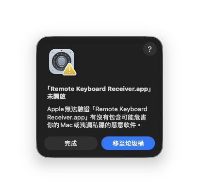
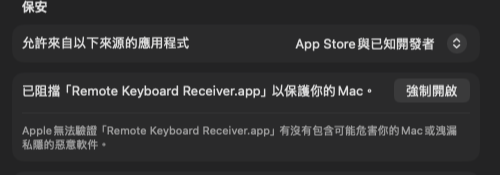
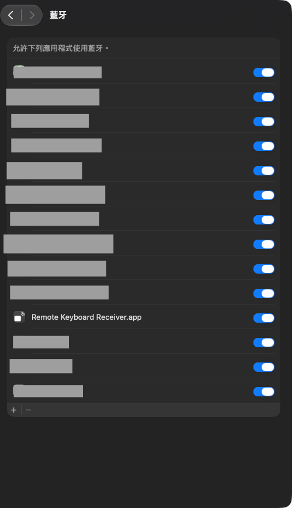
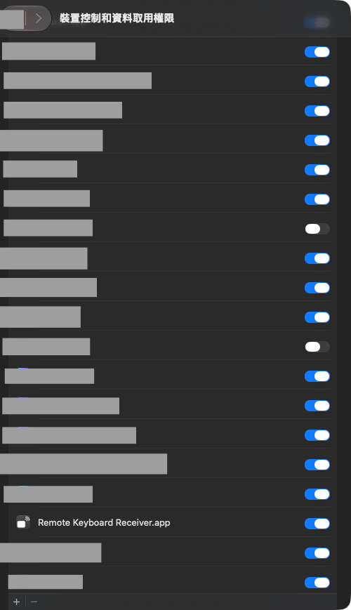
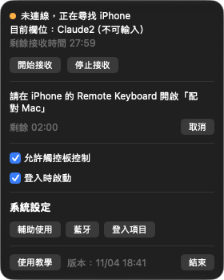

# 04 安裝 Mac Receiver

Mac Receiver 是安裝在 Mac 上的接收程式。iPhone 傳來的文字與觸控板動作，由它輸入到 Mac 目前的 App。它沒有 Dock 圖示，只在選單列顯示一個鍵盤圖示。

需要 macOS 15 以上與 Apple 晶片的 Mac。這個版本沒有經過 Apple 公證，第一次打開時系統會阻擋，需要手動允許。

## 一、下載、驗證並安裝

1. 取得開發者提供的 `RemoteKeyboardReceiver-v版本號-macOS.zip` 與對應的 SHA-256 值。
2. 打開「終端機」，執行下面的指令，把檔案路徑換成你的 zip 位置。

```bash
shasum -a 256 RemoteKeyboardReceiver-v版本號-macOS.zip
```

3. 比對輸出的值與開發者提供的 SHA-256，兩者必須完全相同。值不同時請重新下載，不要安裝。
4. 在 Finder 連按兩下 zip 檔解壓縮。
5. 把解壓縮出來的 **Remote Keyboard Receiver** 拖到「應用程式」資料夾。

## 二、第一次打開

1. 在「應用程式」打開 **Remote Keyboard Receiver**。
2. 系統顯示無法驗證的提示時，按「完成」關閉提示。**不要按「移至垃圾桶」。**



3. 打開「系統設定 > 隱私權與安全性」。
4. 捲到最下方的「安全性」區段。部分系統語言下，這一區的標題顯示為「保安」。
5. 找到「已阻擋「Remote Keyboard Receiver.app」以保護你的 Mac」這一行，按右邊的「強制開啟」。macOS 27 的按鈕是「強制開啟」，較舊的 macOS 可能顯示為「仍要打開」。
6. 依提示輸入 Mac 的密碼或使用 Touch ID。



成功時，Receiver 開啟，Mac 右上方的選單列出現一個鍵盤圖示。

## 三、允許藍牙

1. 第一次打開時，系統詢問是否允許 Remote Keyboard Receiver 使用藍牙，按「允許」。
2. 如果當時按了不允許，打開「系統設定 > 隱私權與安全性 > 藍牙」，開啟 Remote Keyboard Receiver 的開關。也可以在選單列面板按「藍牙」，直接跳到這一頁。



成功時，開關是藍色，面板不再顯示藍牙相關的紅色說明文字。

## 四、允許輔助使用

Receiver 需要「輔助使用」權限，才能把文字輸入到其他 App，並判斷目前是否在密碼欄。

1. 點選單列的鍵盤圖示，打開 Receiver 面板。
2. 按「授權輔助使用」，或「打開輔助使用設定」。這兩個按鈕只在尚未授權時才會出現。
3. 在系統設定的輔助使用清單中，開啟 **Remote Keyboard Receiver** 的開關。
4. 清單裡沒有它時，按清單左下角的「＋」，在「應用程式」資料夾選擇 Remote Keyboard Receiver 加入。
5. 如果開關已開啟，面板仍顯示「輔助使用未授權」，先在清單選取它，按「－」移除，再按「＋」重新加入。



這個清單頁的標題在部分系統版本顯示為「裝置控制和資料取用權限」。

成功時，面板的焦點那一行顯示目前所在的 App 名稱，不再顯示「輔助使用未授權」。

## 五、選單列面板

點選單列的鍵盤圖示，打開面板。面板由上到下的內容如下。



| 項目 | 說明 |
|---|---|
| 版本 | 這個版本的建置時間 |
| Link | 藍牙連線狀態。scanning 表示正在尋找 iPhone，ready 表示已連上並可以打字，括號內是連線所需的毫秒數 |
| 剩餘接收時間 | Receiver 開始接收後的倒數，閒置 30 分鐘會停止接收。沒有在接收時顯示「待命」 |
| 開始接收、停止接收 | 手動開始或停止接收。鍵盤連不上 Mac 時，先按「開始接收」 |
| 配對 | 顯示「已配對 iPhone」或「尚未配對」，以及「配對新 iPhone」與「解除配對」，見 [05 配對](05-pairing.md) |
| 焦點 | Mac 目前輸入的位置，例如「文字編輯（可編輯，epoch 36）（後面的 epoch 數字可以忽略）」或「不可編輯」。尚未授權輔助使用時顯示「輔助使用未授權」 |
| 允許觸控板控制 | 勾選時，iPhone 可以控制 Mac 的游標，見 [07 觸控板](07-trackpad.md) |
| 登入時啟動 | 勾選時，Mac 登入後自動開啟 Receiver。需要在「系統設定 > 登入項目」允許時，面板會出現說明與「打開登入項目設定」 |
| 系統設定 | 「輔助使用」、「藍牙」、「登入項目」三個按鈕，直接跳到對應的系統設定頁面 |
| 結束 | 結束 Receiver，鍵盤就無法連到 Mac |

Link 下方若出現紅字，代表藍牙無法使用，例如「藍牙已關閉，請在 Mac 開啟藍牙」，或「未授權藍牙，請到系統設定 > 隱私權與安全性 允許」，並會附上「打開藍牙設定」按鈕。

完成之後，Receiver 已經可以和 iPhone 配對。

下一章：[05 配對](05-pairing.md)
