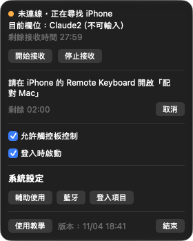
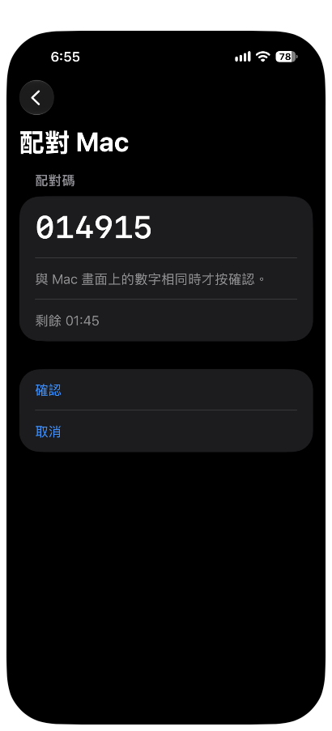
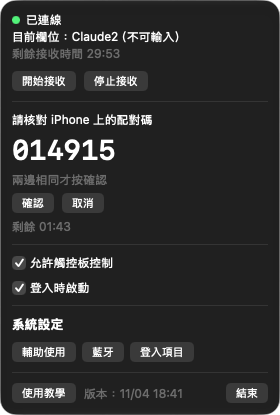
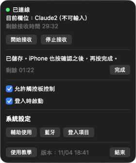
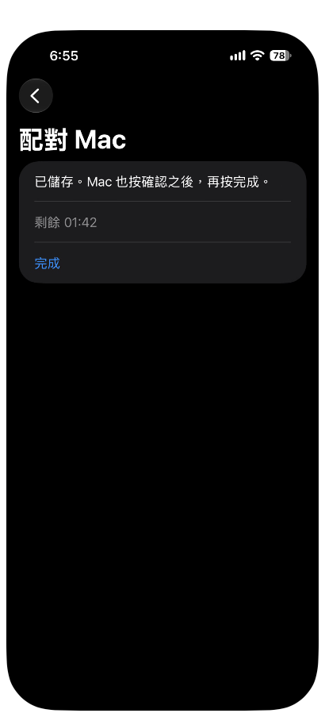
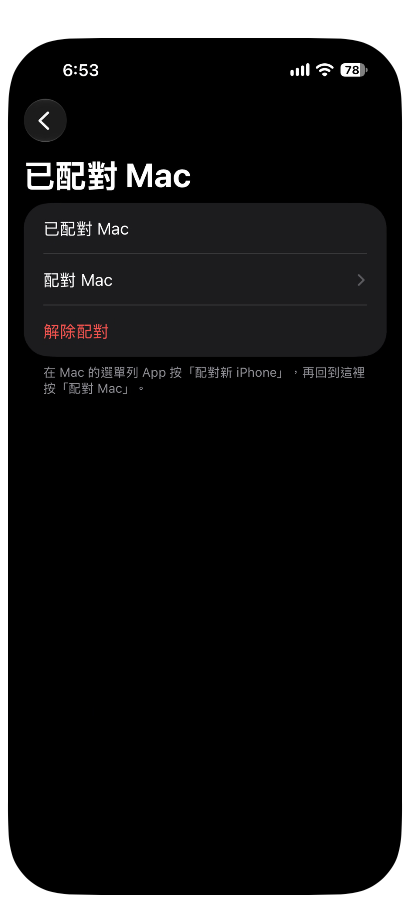
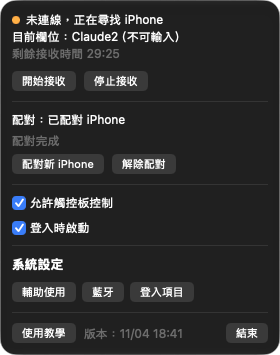

# 05 配對

配對讓 iPhone 與 Mac 互相認得對方。只有配對過的 iPhone 才能把文字送進這部 Mac，所以配對時要核對兩邊畫面上的六位數配對碼。配對只需要做一次。

開始前請確認：

| 項目 | 狀態 |
|---|---|
| Mac | Remote Keyboard Receiver 已開啟，藍牙與輔助使用都已允許（見 [04 安裝 Mac Receiver](04-install-mac-receiver.md)） |
| iPhone | Remote Keyboard 已安裝，藍牙已允許（見 [03 安裝 iPhone App](03-install-iphone-app.md)） |
| 距離 | iPhone 放在 Mac 旁邊 |

配對有時間限制，畫面上會顯示「剩餘 mm:ss」的倒數。超時沒有完成，會顯示「配對逾時，未儲存」，重新開始即可。

## 配對步驟

1. 在 Mac 點選單列的鍵盤圖示，打開 Receiver 面板。
2. 按「配對新 iPhone」。面板顯示「請在 iPhone 的 Remote Keyboard 開啟「配對 Mac」」，並開始倒數。

3. 在 iPhone 打開 **Remote Keyboard**。
4. 在最上方的「設定進度」按「已配對 Mac」（尚未配對時，這一列旁邊顯示「尚未配對」）。三項都完成、只剩一行「設定完成」時，先按「設定完成」展開。
5. 進入「已配對 Mac」頁，按「配對 Mac」。畫面顯示「在 Mac 的選單列 App 按「配對新 iPhone」，這個畫面會自動連上。」，幾秒內會自動連上 Mac。

連上之後，兩邊都會顯示同一組六位數配對碼。

6. 在 iPhone 與 Mac 上，核對兩邊的六位數字是否完全相同。

7. 兩邊的數字相同時，在 Mac 按「確認」。
8. 在 iPhone 按「確認」。

數字不同時，不要按確認，在兩邊都按「取消」，再從步驟 1 重新開始。

9. 兩邊各自顯示「已儲存」。Mac 顯示「已儲存。iPhone 也按確認之後，再按完成。」，iPhone 顯示「已儲存。Mac 也按確認之後，再按完成。」

10. 在 Mac 按「完成」。
11. 在 iPhone 按「完成」。

兩邊都按過「確認」之後，才能按「完成」。

成功時，iPhone 的「已配對 Mac」頁顯示「已配對 Mac」，Mac 面板顯示「配對：已配對 iPhone」與「配對完成」。

## 配對失敗時的訊息

| 位置 | 訊息 | 處理 |
|---|---|---|
| iPhone | 藍牙未開啟，請開啟後再試 | 開啟 iPhone 的藍牙後重試 |
| iPhone | 尚未允許藍牙，請到設定開啟 | 按「到設定開啟藍牙」，開啟藍牙後回來重試 |
| iPhone | 配對逾時，未儲存 | 重新從步驟 1 開始 |
| iPhone | Mac 已取消或連線中斷，未儲存 | 確認 Mac 沒有按取消，重新開始 |
| iPhone | 配對失敗，未儲存 | 重新開始 |
| iPhone | 無法儲存配對，請再試一次 | 按「重試」，或重新開始 |
| Mac | 無法儲存配對，請再試一次 | 重新按「配對新 iPhone」 |
| iPhone | 無法開始配對，請再試一次 | 按「重試」，仍不行就關閉 App 後重開 |
| Mac | 配對失敗，未儲存 | 重新開始 |
| Mac | 配對已取消 | 重新開始 |

藍牙相關的失敗，請先確認 Mac 面板最上方沒有紅字說明。

## 重新配對與解除配對

| 情況 | 做法 |
|---|---|
| 鍵盤顯示「配對驗證失敗」，或想換一部 iPhone | 兩邊重新配對：Mac 按「配對新 iPhone」，iPhone 按「配對 Mac」，核對配對碼後兩邊都按「確認」，最後按「完成」 |
| 想取消這一組配對 | 在 Mac 面板按「解除配對」，在 iPhone 的「設定進度 > 已配對 Mac」頁按「解除配對」 |

解除配對之後，iPhone 鍵盤在遠端模式會顯示「尚未配對」，需要重新配對才能傳送文字。

## 更新之後

| 更新對象 | 配對 | 需要做的事 |
|---|---|---|
| Mac Receiver | 保留，不用重新配對 | 重新允許輔助使用，見 [04 安裝 Mac Receiver](04-install-mac-receiver.md) |
| iPhone App | 同一個 Apple 帳號簽署時保留 | 打開 App，確認「設定進度」的「已配對 Mac」顯示「已配對」 |

詳細的更新方式見 [09 續簽與更新](09-refresh-and-update.md)。

下一章：[06 使用鍵盤](06-using-the-keyboard.md)
