# 06 使用鍵盤

本章說明如何用 Remote Keyboard 打字，包括英文、符號、手寫與速成，以及鍵盤上方各種提示的意思。

開始前請確認已完成配對（見 [05 配對](05-pairing.md)），Mac 的 Receiver 已開啟，而且 Mac 目前的游標停在一個文字欄位，例如「文字編輯」的文件。

## 切換到 Remote Keyboard

1. 在 iPhone 任一個輸入框點一下，叫出鍵盤。可以使用 Remote Keyboard 主畫面的「測試輸入」。
2. 按住鍵盤左下角的地球鍵，在清單選擇 **Remote Keyboard**。連按地球鍵也可以依序切換鍵盤。

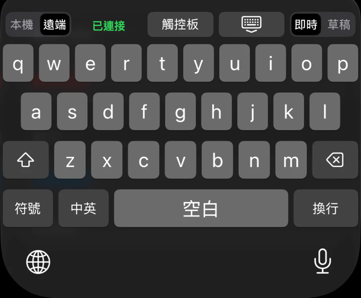

成功時，鍵盤上方出現「本機」與「遠端」切換。選了「遠端」並已連上 Mac 時，中間顯示綠色的「已連接」。

## 頂部列

| 位置 | 項目 | 說明 |
|---|---|---|
| 最左 | 本機、遠端 | 決定文字送到哪裡 |
| 左中 | 狀態文字 | 顯示連線與 Mac 的狀態，見下方「狀態列」 |
| 中右 | 觸控板 | 切換到觸控板，見 [07 觸控板](07-trackpad.md)。沒有連上 Mac 時是灰色，不能按 |
| 中右 | 鍵盤加向下箭頭的按鍵 | 收起鍵盤 |
| 最右 | 即時、草稿 | 決定文字何時送出 |

## 本機與遠端

| 選擇 | 文字去向 |
|---|---|
| 本機 | 直接輸入到 iPhone 目前的 App，不傳到 Mac |
| 遠端 | 經藍牙加密傳到已配對的 Mac，輸入到 Mac 目前的欄位 |

選「本機」時，頂部只剩切換與收起鍵盤，沒有狀態文字、觸控板與即時、草稿。

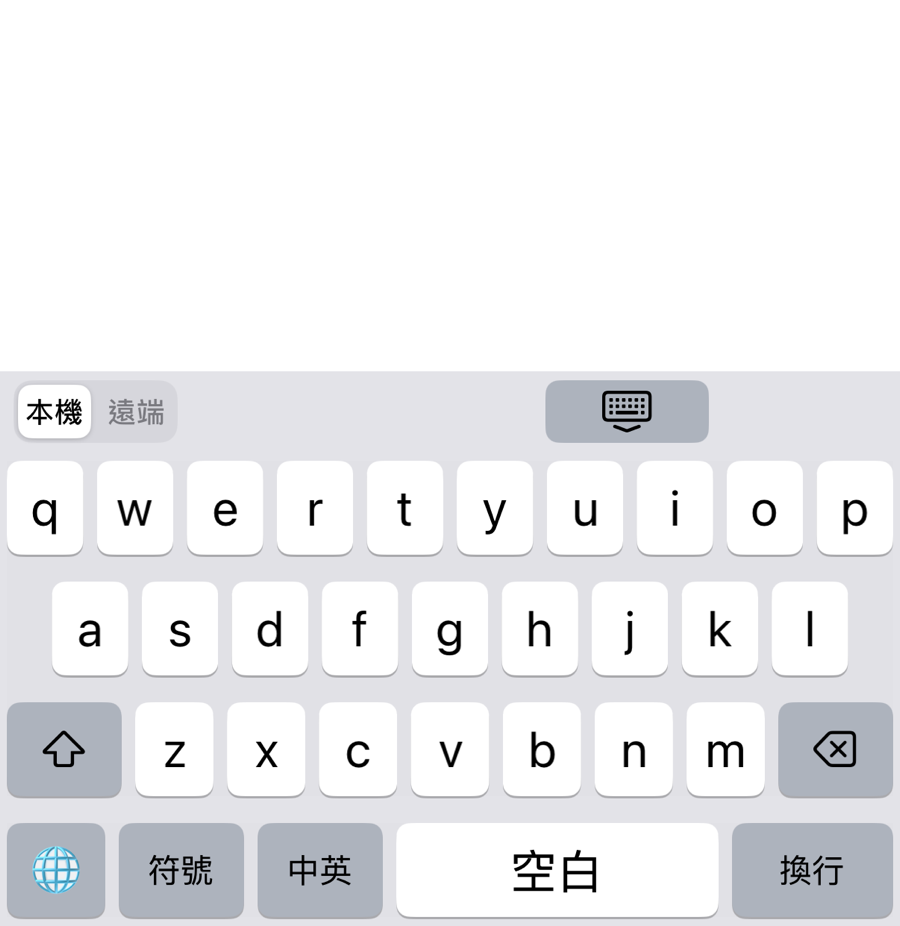

## 即時與草稿

在「遠端」模式下，可以選擇文字如何送出。

| 選擇 | 運作方式 | 適合 |
|---|---|---|
| 即時 | 每按一個鍵，文字立刻出現在 Mac | 一般打字 |
| 草稿 | 先在鍵盤上方的草稿列編輯，按「傳送」才一次送到 Mac | 想先檢查或修改再送出 |

### 草稿列

選「草稿」之後，頂部下方多出一列草稿。

| 項目 | 說明 |
|---|---|
| 左右箭頭鍵 | 把草稿裡的游標左移或右移一格 |
| 草稿文字 | 點一下文字，游標移到手指的位置；按住手指左右拖曳，游標連續移動。之後打的字會插入游標處 |
| 傳送 | 把草稿送到 Mac，並清空草稿列 |

草稿是空白時，草稿列顯示「輸入草稿」。

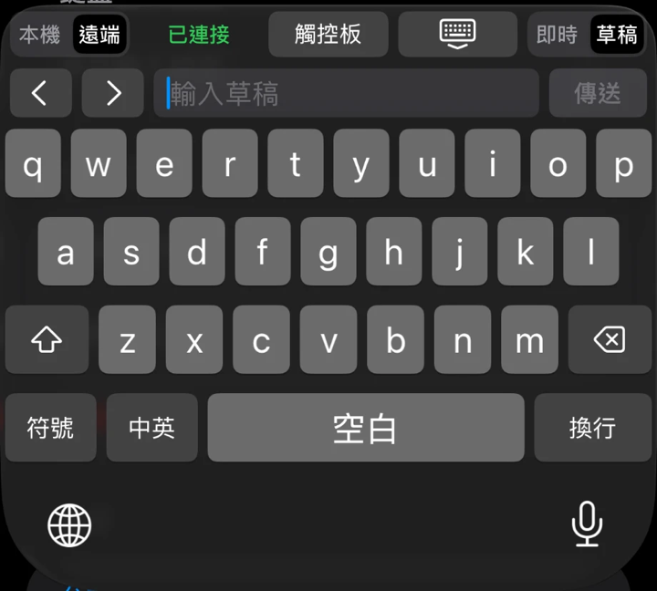

成功時，按下「傳送」後，草稿的文字出現在 Mac 目前的欄位。

## 英文

預設頁面是英文鍵盤。

| 按鍵 | 說明 |
|---|---|
| 大寫鍵 | 有三種狀態：關閉、下一個字母大寫、鎖定大寫 |
| 刪除鍵 | 按一下刪一個字，按住會連續刪除 |
| 空白 | 空白鍵 |
| 換行 | 換行 |
| 地球鍵 | 切換到下一個鍵盤 |

## 符號

1. 按左下方的「符號」，切換到數字與符號頁。
2. 需要更多符號時，按左側的「#+=」切換符號層。
3. 按「ABC」回到英文字母頁。從中文頁進入符號頁時，這個按鍵顯示為「中」，按下去回到中文頁。

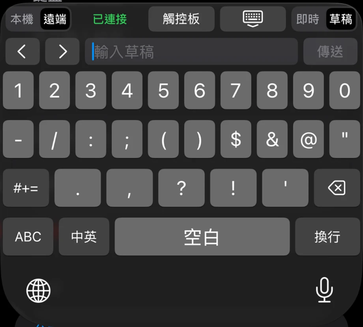

## 中文

按「中英」切換中文與英文。中文頁使用哪一種輸入方式，在 App 的「中文輸入設定」選擇（見 [08 App 設定](08-app-settings.md)），可以選「手寫」或「速成」。

### 手寫

手寫需要先在 App 的「中文輸入設定」下載手寫模型，並開啟「允許完整取用」。沒有完整取用時，中文頁會改用速成。

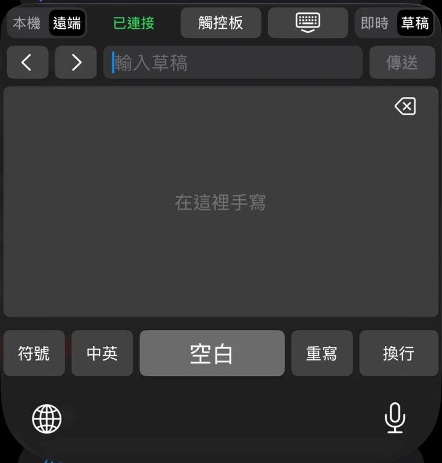

1. 在書寫區用手指寫一個字。
2. 書寫區上方會出現候選字，向左滑動可以看到更多。
3. 點選你要的字，字就會輸入。
4. 寫錯時，按右下方的「重寫」清除書寫區。候選列最右邊的刪除鍵可以刪除已輸入的字。

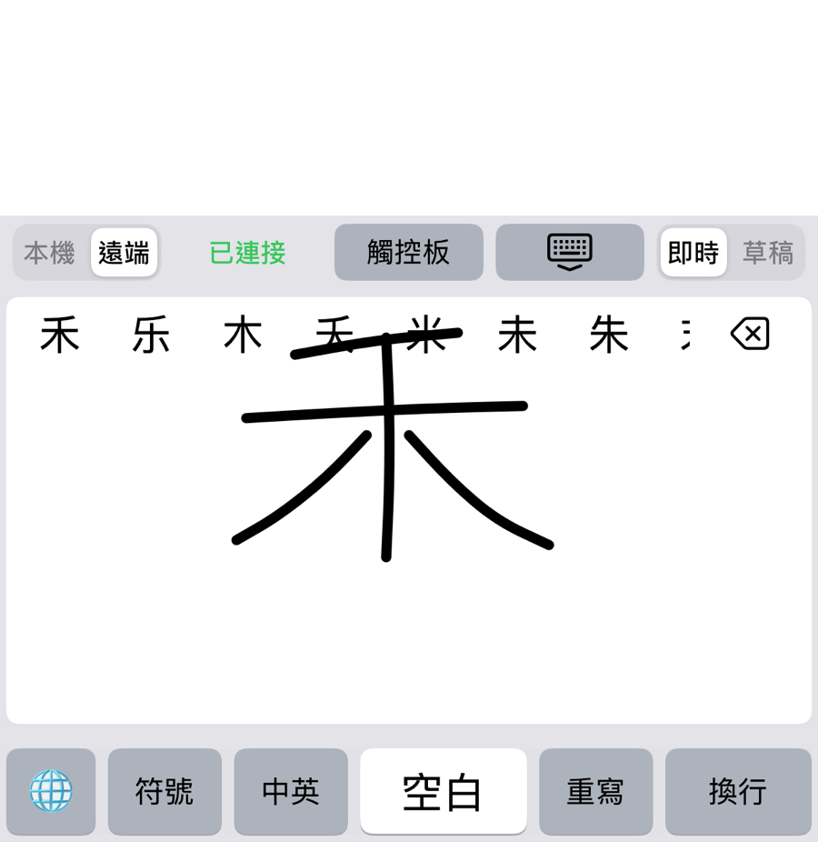

底部列有「符號」、「中英」、「空白」、「重寫」與「換行」。

### 速成

速成頁和英文頁的字母位置相同，每個按鍵的主字是字根，右上角的小字是對應的英文字母。

1. 依速成的規則按字根鍵。
2. 輸入碼會以藍色顯示在候選列的最左邊，後面是候選字。
3. 點選候選字輸入。第一個候選字有淺色底，按「空白」可以直接輸入它。

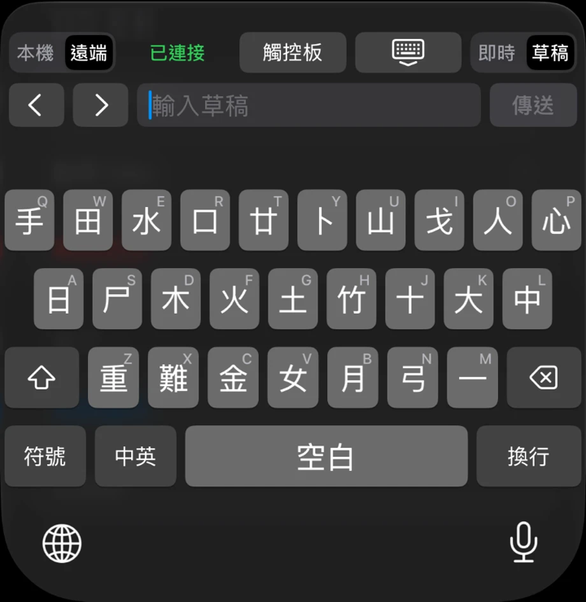

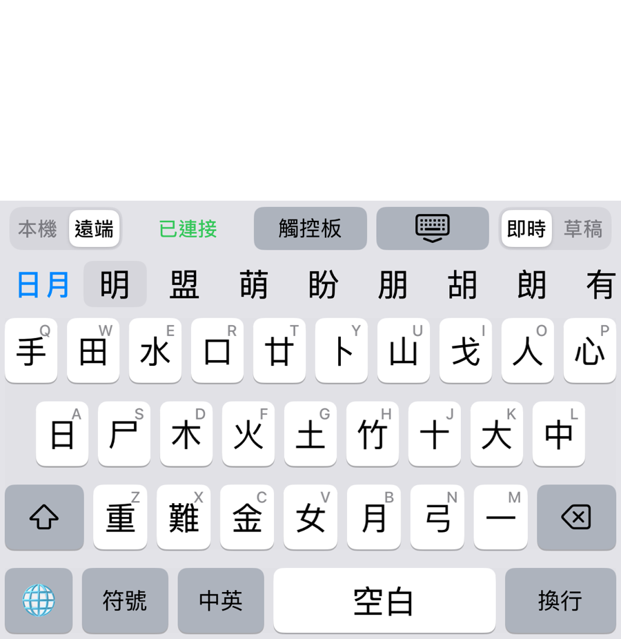

## 收起鍵盤

按頂部列中間偏右、有向下箭頭的按鍵，可以收起鍵盤。

## 狀態列

狀態文字在遠端模式下，位於「本機」「遠端」切換的右邊。綠色表示正常，紅色表示需要處理。

| 文字 | 意思 | 處理 |
|---|---|---|
| 已連接 | 已連上 Mac，可以打字 | 不需要處理 |
| 未連接 | iPhone 找不到或連不上 Mac | 見下方「未連接」 |
| 尚未配對 | 這支 iPhone 還沒和 Mac 配對 | 打開 Remote Keyboard，依 [05 配對](05-pairing.md) 配對。尚未配對時，觸控板也不能使用 |
| 密碼不能輸入 | Mac 目前在密碼欄、開啟了安全輸入，或螢幕已鎖定 | 見下方「密碼的處理」 |
| Mac 未授權輔助使用 | Mac 的 Receiver 還沒有輔助使用權限 | 在 Mac 依 [04 安裝 Mac Receiver](04-install-mac-receiver.md) 允許 |

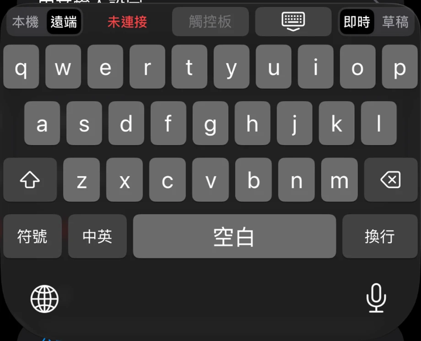

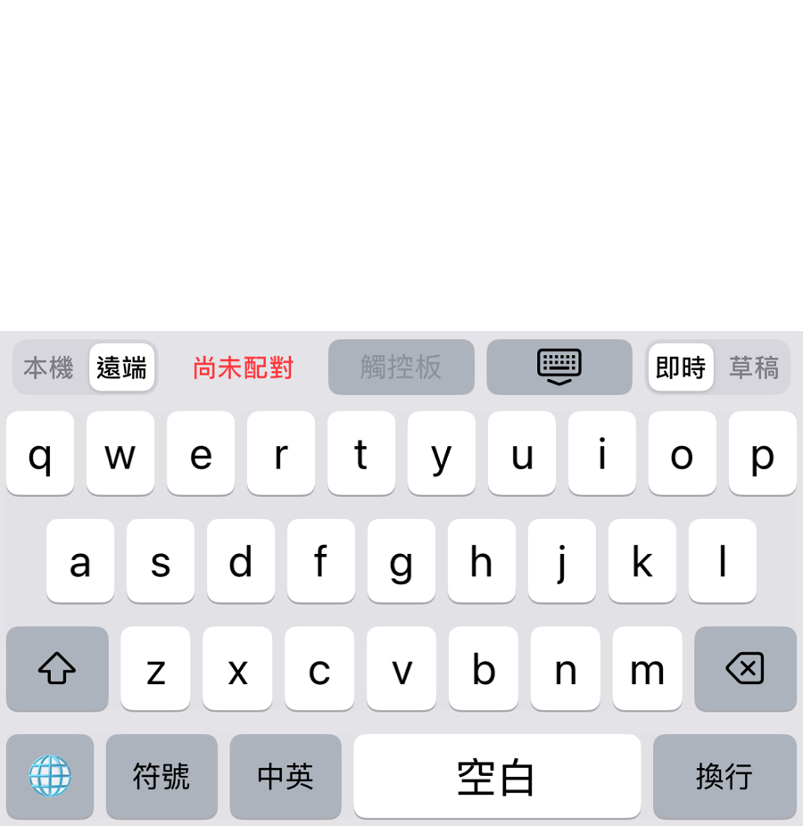

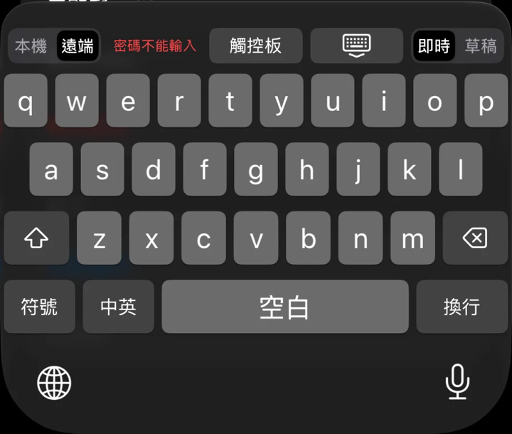

### 未連接

1. 確認 Mac 的 Receiver 已開啟，並且面板的 Link 是 ready 或 scanning。
2. 在 Mac 點一下文字欄位，或從選單列打開 Receiver，按「開始接收」。Receiver 閒置 30 分鐘會停止接收。
3. 確認 iPhone 與 Mac 的藍牙都已開啟。
4. 收起鍵盤再重新叫出，鍵盤會自動重新連線。

### 提示訊息

打字時如果文字沒有送到 Mac，狀態列會暫時改顯示一則提示，紅色字。

| 提示 | 意思 | 處理 |
|---|---|---|
| Mac 沒有輸入欄位，未輸入 | Mac 目前的位置不是文字欄位，例如在 Finder 的桌面 | 在 Mac 點一下要輸入的文字欄位，再重新打字 |
| Mac 未連接，未輸入 | 打字時連線已經中斷 | 見上方「未連接」，再重新打字 |
| Mac 尚未就緒，未輸入 | 剛連上，Mac 還沒回報狀態 | 等一下再打字 |
| 焦點已改變，未輸入 | 打字的同時，Mac 切換了視窗或欄位 | 確認 Mac 目前的欄位，再重新打字 |
| Mac 正在組字，未輸入 | Mac 的輸入法正在組字 | 在 Mac 完成或取消組字，再重新打字 |
| 輸入法切換失敗 | Mac 無法自動切換到英文輸入 | 在 Mac 手動切換到英文輸入法，再重新打字 |
| Mac 輸入失敗、Mac 無法處理、順序錯誤，未輸入 | 這一次的輸入沒有成功 | 重新打字；一直出現時，結束 Receiver 再重新開啟 |
| N 個按鍵未確認是否送達（N 為數字） | 連線中斷時，有幾個按鍵沒有收到 Mac 的確認 | 到 Mac 檢查文字，把缺少或重複的部分補上或刪掉 |

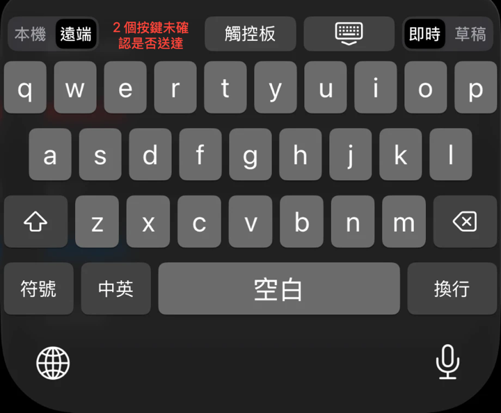

連線不穩時，文字可能遺漏或重複，重要的內容請在送出前再檢查一次。

## 密碼的處理

為了安全，下列情況 Mac 的 Receiver 不會輸入文字，鍵盤顯示「密碼不能輸入」。

| 情況 | 說明 |
|---|---|
| 密碼欄 | 游標在系統標示為密碼欄的欄位 |
| 安全輸入 | 某個 App 開啟了安全輸入，例如終端機的「安全鍵盤輸入」 |
| 鎖定畫面 | Mac 的螢幕已鎖定 |

這時兩種送出方式的行為如下。

| 送出方式 | 行為 |
|---|---|
| 即時 | 打的字不會送出，也不會保留 |
| 草稿 | 文字與換行會被丟棄，刪除鍵與游標仍可使用，傳送會被 Mac 拒絕，文字不會輸入密碼欄 |

鎖定期間打的字，解鎖後不會補送。

### 其他 App 忘了關閉安全輸入

其他 App 忘了關閉安全輸入時，一般欄位也會顯示「密碼不能輸入」。關閉那個 App 的安全輸入就會恢復。常見的原因：

1. 終端機開啟了「安全鍵盤輸入」。
2. 瀏覽器仍有分頁停在密碼欄。關閉那些分頁。

### 偵測不到的情況

這項保護只涵蓋系統標示為密碼欄的欄位。下列情況偵測不到，文字仍會送出：

| 情況 | 說明 |
|---|---|
| 其他終端機 App 內的 sudo、ssh 等密碼提示 | macOS 27.2 的 Apple 終端機在隱藏輸入時有擋下文字，其他終端機與系統版本未驗證 |
| 遠端桌面或虛擬機視窗內的密碼欄 | 偵測不到 |
| 自行繪製、未標示為密碼欄的輸入框 | 偵測不到 |

**請不要用這個鍵盤輸入密碼。** 詳細說明見 [隱私說明](../distribution/privacy-note.md)。

下一章：[07 觸控板](07-trackpad.md)
