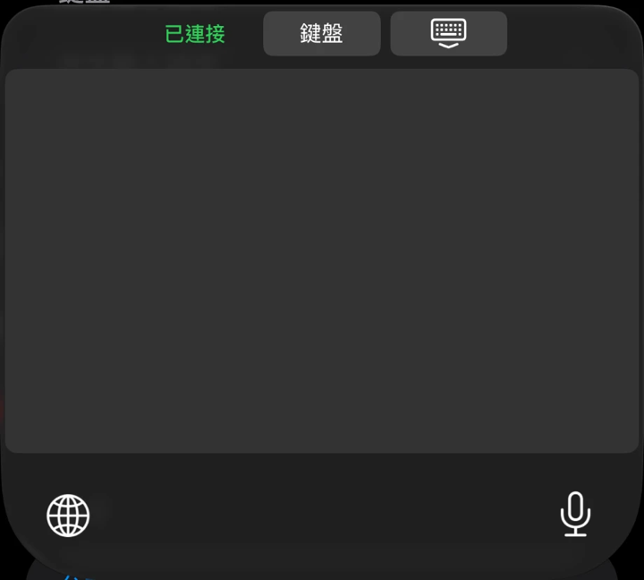
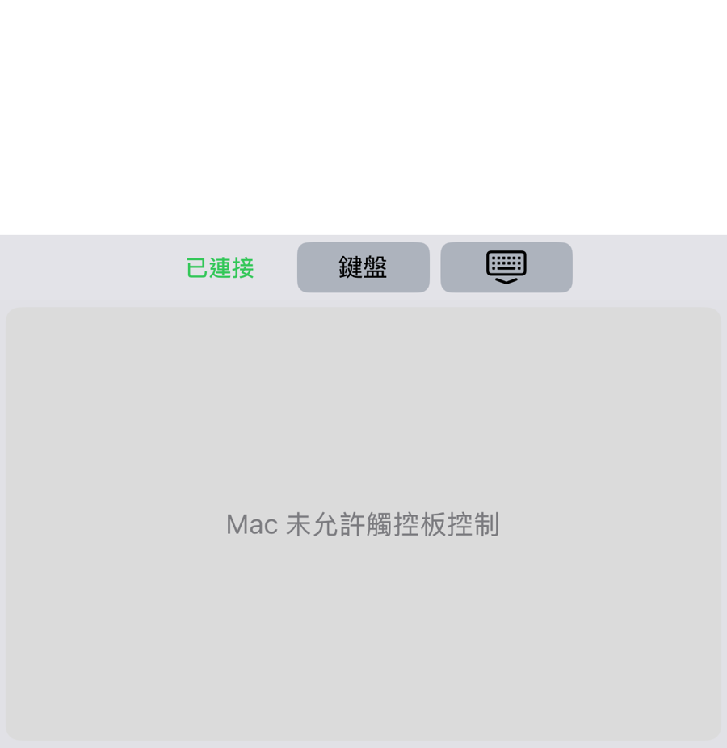

# 07 觸控板

觸控板模式讓你用 iPhone 的鍵盤區當作 Mac 的觸控板，移動游標、點按、拖曳與捲動。

使用前需要：

| 項目 | 說明 |
|---|---|
| 配對 | iPhone 與 Mac 已配對（見 [05 配對](05-pairing.md)） |
| 連線 | 鍵盤處於「遠端」模式，狀態列顯示「已連接」 |
| Mac 設定 | Mac 面板的「允許觸控板控制」已勾選 |
| 輔助使用 | Mac 的 Receiver 已取得輔助使用權限（見 [04 安裝 Mac Receiver](04-install-mac-receiver.md)） |

## 開啟與離開觸控板

1. 在 Mac 點選單列的鍵盤圖示，確認「允許觸控板控制」已勾選。
2. 在 iPhone 叫出 Remote Keyboard，選「遠端」。
3. 按頂部列的「觸控板」。
4. 鍵盤區變成一整片灰色的觸控板。

5. 要回到打字，按頂部列的「鍵盤」。

成功時，在灰色區域移動手指，Mac 的游標跟著移動。

## 手勢

| 動作 | 手勢 |
|---|---|
| 移動游標 | 一根手指在觸控板上滑動 |
| 點一下（左鍵單擊） | 一根手指快速輕點一下 |
| 雙擊 | 快速連續輕點兩下，兩次要在差不多的位置 |
| 右鍵 | 兩根手指同時快速輕點一下 |
| 拖曳（方法一） | 輕點一下，馬上再用同一根手指按下並按住，然後移動；放開手指就放開拖曳 |
| 拖曳（方法二） | 一根手指按住不動約 0.4 秒，再移動；放開手指就放開拖曳 |
| 捲動 | 兩根手指一起上下左右滑動 |

使用上的提醒：

| 提醒 | 說明 |
|---|---|
| 輕點要快 | 手指停留太久，不會當成點一下 |
| 輕點時不要移動 | 手指稍微滑動就會變成移動游標，不會點下去 |
| 拖曳 | 方法一的第二下要在輕點後的短時間內按下，按住一下或開始移動，就會變成拖曳，不會變成雙擊 |
| 捲動 | 放開其中一根手指，就會結束這次捲動 |

觸控板的靈敏度與傳輸次數，在 App 的「觸控板」調整，見 [08 App 設定](08-app-settings.md)。

## 找不到觸控板或無法使用時

| 畫面文字 | 意思 | 處理 |
|---|---|---|
| Mac 未允許觸控板控制 | Mac 面板的「允許觸控板控制」沒有勾選 | 在 Mac 打開選單列面板，勾選「允許觸控板控制」 |
| 正在連接觸控板… | 觸控板通道正在建立 | 稍等幾秒 |
| 無法連接觸控板，請按鍵盤再按觸控板重試 | 通道建立逾時 | 按「鍵盤」，再按「觸控板」重試 |
| 尚未連線 Mac | iPhone 沒有連上 Mac | 見 [06 使用鍵盤](06-using-the-keyboard.md) 的「未連接」 |

「觸控板」按鍵是灰色，表示鍵盤尚未連上 Mac 或尚未配對。

## 安全提醒

Mac 螢幕鎖定時，已配對的 iPhone 仍可能移動游標與點按。不需要使用時，可以在 Mac 面板取消勾選「允許觸控板控制」。

下一章：[08 App 設定](08-app-settings.md)
