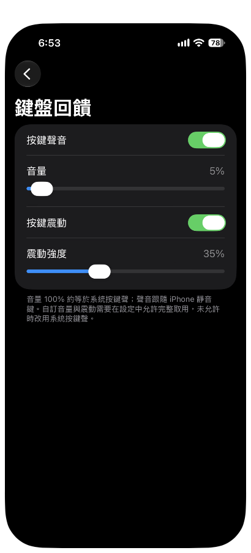
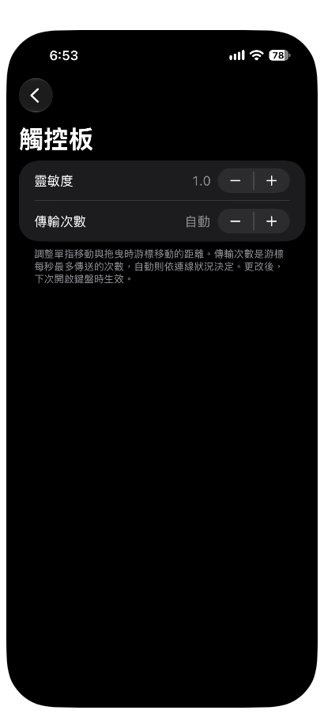
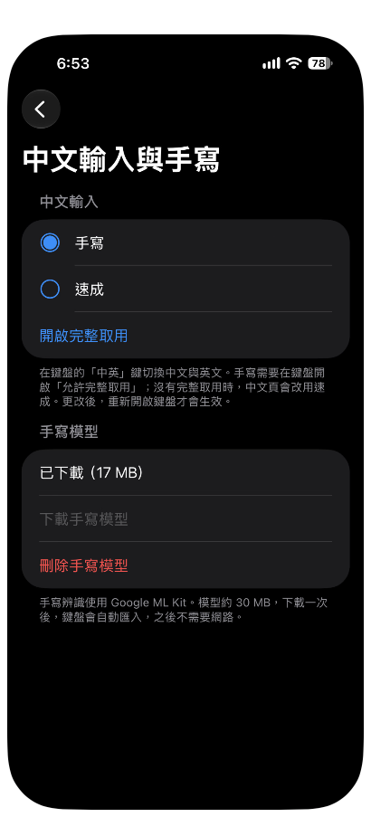
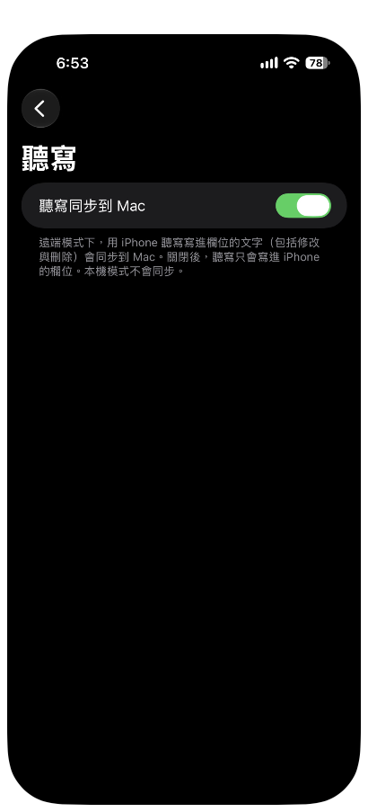
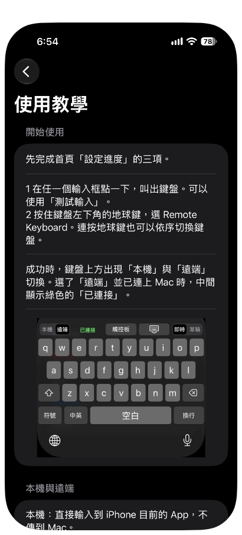

# 08 App 設定

鍵盤的設定都在 iPhone 的 Remote Keyboard App 裡。

## 主畫面

打開 **Remote Keyboard**，主畫面由上到下有四個區塊。

| 區塊 | 項目 | 說明 |
|---|---|---|
| 設定進度 | 藍牙、已配對 Mac、加入鍵盤並允許完整取用 | 三項都完成後，收成一行「設定完成」，按一下可以展開 |
| 設定 | 鍵盤回饋、觸控板、中文輸入與手寫、聽寫 | 各進入一頁，見下面各節 |
| 幫助 | 使用教學、測試輸入、關於與授權 | 見下面各節 |
| 最下方 | GitHub 連結、版權一行、法律聲明 | 見「GitHub 與法律聲明」 |

## 設定進度

按「設定完成」展開後，可以看到三項。

| 項目 | 說明 |
|---|---|
| 藍牙 | 按一下要求藍牙授權，右側顯示目前狀態。顯示已拒絕時，按「到設定開啟藍牙」 |
| 已配對 Mac | 右側顯示「已配對」或「尚未配對」。按一下進入配對頁，有「配對 Mac」與「解除配對」，見 [05 配對](05-pairing.md) |
| 加入鍵盤並允許完整取用 | 按一下跳到設定 App 的 Remote Keyboard 頁面。要等鍵盤在有「允許完整取用」的情況下出現過一次，才會打勾 |

尚未全部完成時，三項直接列在「設定進度」下方，並提示「鍵盤出現過一次後才會打勾。」

## 鍵盤回饋

在主畫面的「設定」按「鍵盤回饋」。

| 項目 | 說明 |
|---|---|
| 按鍵聲音 | 開關。開啟時，按鍵會發出聲音 |
| 音量 | 拉桿。100% 約等於系統按鍵聲，聲音跟隨 iPhone 的靜音鍵 |
| 按鍵震動 | 開關。開啟時，按鍵會震動 |
| 震動強度 | 拉桿，調整震動的強度 |

自訂音量與震動需要「允許完整取用」。沒有允許時，改用系統按鍵聲。拖動時會連續試播。

## 觸控板

在主畫面的「設定」按「觸控板」。

| 項目 | 說明 |
|---|---|
| 靈敏度 | 用「+」與「－」調整。調整單指移動與拖曳時，游標移動的距離 |
| 傳輸次數 | 用「+」與「－」調整。游標每秒最多傳送的次數；顯示「自動」時，依連線狀況決定 |

靈敏度與傳輸次數更改後，下次開啟鍵盤時生效。

## 中文輸入與手寫

在主畫面的「設定」按「中文輸入與手寫」。

### 中文輸入

| 項目 | 說明 |
|---|---|
| 手寫 | 中文頁使用手寫 |
| 速成 | 中文頁使用速成 |
| 開啟完整取用 | 跳到設定，開啟鍵盤的完整取用 |

目前選用的方式前面有實心圓點。在鍵盤用「中英」鍵切換中文與英文。手寫需要「允許完整取用」；沒有完整取用時，中文頁會改用速成。更改後，重新開啟鍵盤才會生效。

### 手寫模型

手寫辨識使用 Google ML Kit。模型約 30 MB，下載一次後，鍵盤會自動匯入，之後不需要網路。

| 項目 | 說明 |
|---|---|
| 狀態文字 | 顯示「尚未下載」、「下載中」與百分比、「正在放入鍵盤共用位置…」、「已下載」與大小，或「失敗」與原因 |
| 下載手寫模型 | 開始下載。需要連上網路 |
| 刪除手寫模型 | 按下後詢問「刪除手寫模型？」，按「刪除」確認。刪除後，鍵盤會在下次顯示時移除它的副本，手寫頁需要重新下載模型才能使用 |

下載手寫模型時，ML Kit 會連到 Google 下載模型並傳送使用與效能資料，詳情見 [隱私說明](../distribution/privacy-note.md)。不想連到 Google，可以不下載手寫模型，改用速成或英文。

成功時，狀態文字顯示「已下載」並附上大小，之後鍵盤的手寫頁就可以辨識。

## 聽寫

在主畫面的「設定」按「聽寫」。

| 項目 | 說明 |
|---|---|
| 聽寫同步到 Mac | 遠端模式下，用 iPhone 的聽寫寫進欄位的文字，包括修改與刪除，會同步到 Mac。關閉後，聽寫只會寫進 iPhone 的欄位。本機模式不會同步 |

聽寫由 iOS 處理，適用 Apple 的聽寫隱私規定。

## 使用教學

在主畫面的「幫助」按「使用教學」。

教學有開始使用、本機與遠端、即時與草稿、輸入方式、觸控板手勢、密碼保護六段，最下方的「看完整手冊」連到這份手冊。第一次打開 App 的四頁引導，內容是這個 App 做什麼、在 Mac 安裝 Receiver、開啟權限與加入鍵盤、配對 Mac，可以略過。

## 測試輸入

在主畫面的「幫助」按「測試輸入」。畫面有一個輸入框，點一下叫出鍵盤，按住地球鍵選 Remote Keyboard，就可以在這個 App 裡試用鍵盤。

## 關於與授權

在主畫面的「幫助」按「關於與授權」。

| 項目 | 說明 |
|---|---|
| 版本 | 這個版本的建置時間 |
| 授權 | 列出手寫辨識（Google ML Kit）的條款連結，以及速成字碼表的授權說明 |

## GitHub 與法律聲明

主畫面最下方有「GitHub：AnsonHui6040/Mac-keyboard」連結，按一下會打開專案的 GitHub 頁面。下一列的「法律聲明」有免責聲明、權利聲明與第三方聲明三段文字，最下方是版權一行。這些文字與 [專案首頁](../../README.md) 最後的「法律聲明」相同。

下一章：[09 續簽與更新](09-refresh-and-update.md)
