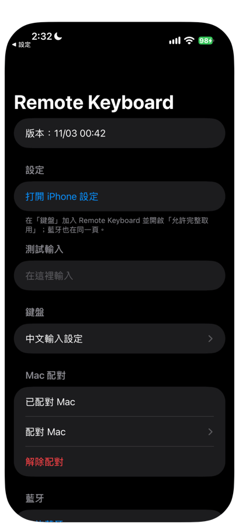
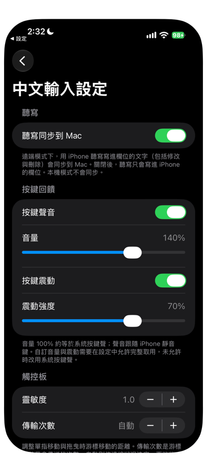

# 08 App 設定

鍵盤的設定都在 iPhone 的 Remote Keyboard App 裡。

## 主畫面

打開 **Remote Keyboard**，主畫面有下面幾個區塊。

| 區塊 | 項目 | 說明 |
|---|---|---|
| 版本 | 版本字串 | 這個版本的建置日期與時間 |
| 設定 | 打開 iPhone 設定 | 跳到設定 App 的 Remote Keyboard 頁面，那裡可以開啟鍵盤的「允許完整取用」與藍牙 |
| 測試輸入 | 輸入框 | 可以在這裡試用鍵盤 |
| 鍵盤 | 中文輸入設定 | 進入設定頁，見下一節 |
| Mac 配對 | 配對 Mac、解除配對 | 見 [05 配對](05-pairing.md) |
| 藍牙 | 允許藍牙 | 要求藍牙授權，並顯示目前狀態 |

## 中文輸入設定

在主畫面的「鍵盤」區，按「中文輸入設定」。這一頁的名稱雖然是中文輸入設定，裡面也包含聽寫、按鍵聲音、震動與觸控板的設定。

### 聽寫

| 項目 | 說明 |
|---|---|
| 聽寫同步到 Mac | 遠端模式下，用 iPhone 的聽寫寫進欄位的文字，包括修改與刪除，會同步到 Mac。關閉後，聽寫只會寫進 iPhone 的欄位。本機模式不會同步 |

聽寫由 iOS 處理，適用 Apple 的聽寫隱私規定。

### 按鍵回饋

| 項目 | 說明 |
|---|---|
| 按鍵聲音 | 開關。開啟時，按鍵會發出聲音 |
| 音量 | 拉桿。100% 約等於系統按鍵聲，聲音跟隨 iPhone 的靜音鍵 |
| 按鍵震動 | 開關。開啟時，按鍵會震動 |
| 震動強度 | 拉桿，調整震動的強度 |

自訂音量與震動需要「允許完整取用」。沒有允許時，改用系統按鍵聲。調整拉桿時會試播一次。

### 觸控板

| 項目 | 說明 |
|---|---|
| 靈敏度 | 用「+」與「－」調整。調整單指移動與拖曳時，游標移動的距離 |
| 傳輸次數 | 用「+」與「－」調整。游標每秒最多傳送的次數；顯示「自動」時，依連線狀況決定 |

靈敏度與傳輸次數更改後，下次開啟鍵盤時生效。

### 中文輸入

| 項目 | 說明 |
|---|---|
| 手寫 | 中文頁使用手寫 |
| 速成 | 中文頁使用速成 |
| 開啟完整取用 | 跳到設定，開啟鍵盤的完整取用 |

目前選用的方式前面有實心圓點。在鍵盤用「中英」鍵切換中文與英文。手寫需要「允許完整取用」；沒有完整取用時，中文頁會改用速成。更改後，重新開啟鍵盤才會生效。

### 授權

「授權」列出手寫辨識（Google ML Kit）的條款連結，以及速成字碼表的授權說明。

### 手寫模型

手寫辨識使用 Google ML Kit。模型約 30 MB，下載一次後，鍵盤會自動匯入，之後不需要網路。

| 項目 | 說明 |
|---|---|
| 狀態文字 | 顯示「尚未下載」、「下載中」與百分比、「正在放入鍵盤共用位置…」、「已下載」與大小，或「失敗」與原因 |
| 下載手寫模型 | 開始下載。需要連上網路 |
| 刪除手寫模型 | 按下後詢問「刪除手寫模型？」，按「刪除」確認。刪除後，鍵盤會在下次顯示時移除它的副本，手寫頁需要重新下載模型才能使用 |

下載手寫模型時，ML Kit 會連到 Google 下載模型並傳送使用與效能資料，詳情見 [隱私說明](../distribution/privacy-note.md)。不想連到 Google，可以不下載手寫模型，改用速成或英文。

成功時，狀態文字顯示「已下載」並附上大小，之後鍵盤的手寫頁就可以辨識。

下一章：[09 續簽與更新](09-refresh-and-update.md)
