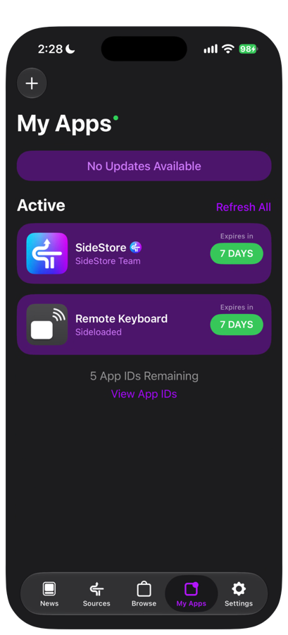

# 09 續簽與更新

免費 Apple 帳號簽署的 App 只有 7 天有效。到期前要續簽（Refresh），有新版本時要更新。

## 7 天續簽

1. 打開 SideStore 的 **My Apps**，查看 Remote Keyboard 與 SideStore 的到期日。
2. 到期前，確認 iPhone 連上 Wi-Fi，且 LocalDevVPN 顯示「已連線」。
3. 按 App 旁邊的天數（例如「7 DAYS」）進行 Refresh。
4. 確認天數已更新。
5. 打開 Remote Keyboard，確認可以正常使用。

成功時，兩個 App 的天數都回到 7 DAYS。My Apps 頁面右上方的 **Refresh All** 可以一次續簽全部。

| 提醒 | 說明 |
|---|---|
| 背景續簽 | SideStore 會嘗試在背景自動續簽，但這取決於系統的背景執行條件，不保證每次成功 |
| 建議 | 每 3 至 5 天手動確認一次到期日 |
| 到期後 | App 圖示點了打不開。連上 Wi-Fi 與 LocalDevVPN 後 Refresh，不要刪除 App |

## 更新 iPhone App

1. 取得新版 IPA，核對 SHA-256（做法見 [03 安裝 iPhone App](03-install-iphone-app.md)）。
2. 確認仍使用同一個 Apple 帳號。
3. **不要先刪除舊版。**
4. 連上 Wi-Fi 與 LocalDevVPN。
5. 在 SideStore 的 My Apps 按「+」，選擇新版 IPA。
6. 詢問 App Extension 時，選「Keep App Extensions (Register App ID for Each Extension)」。
7. 打開 App，確認「Mac 配對」顯示「已配對 Mac」，設定都還在。

成功時，主畫面的版本字串已更新，配對與設定保留。

## 更新 Mac Receiver

1. 取得新版 zip，核對 SHA-256（做法見 [04 安裝 Mac Receiver](04-install-mac-receiver.md)）。
2. 結束舊版：點選單列的鍵盤圖示，按「結束」。
3. 解壓縮新版，把 App 拖到「應用程式」，取代舊版。
4. 第一次打開時，依 [04 安裝 Mac Receiver](04-install-mac-receiver.md) 的方式允許打開。
5. 重新允許輔助使用。如果開關已開啟，面板仍顯示「輔助使用未授權」，先從清單移除，再按「＋」重新加入。
6. 藍牙若被要求重新授權，同樣允許。

成功時，面板的配對區仍顯示「已配對 iPhone」，不需要重新配對。

## 什麼情況會遺失資料

| 情況 | 結果 |
|---|---|
| 先刪除舊版 App 再安裝 | 配對與設定會遺失 |
| 換另一個 Apple 帳號簽署 | 視為不同的 App，配對與設定會遺失，要重新配對 |
| 讓 App 過期後被移除 | 可能遺失，請在到期前續簽 |

發生以上情況時，請依 [05 配對](05-pairing.md) 重新配對，手寫模型也要到 App 重新下載（見 [08 App 設定](08-app-settings.md)）。

下一章：[10 疑難排解](10-troubleshooting.md)
