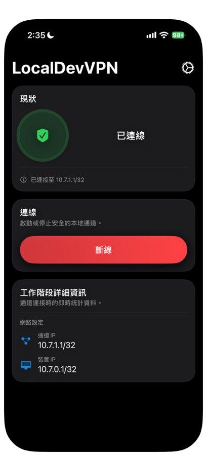
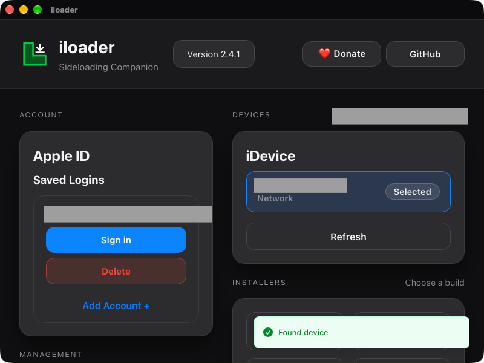
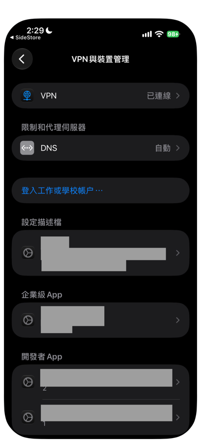

# 02 Install SideStore

SideStore is a tool that lets an iPhone install apps from outside the App Store. In this chapter you use your own free Apple Account to put SideStore on your iPhone.

Before you start, make sure the iPhone and the Mac are both on Wi-Fi, and have a USB cable ready. For the official instructions, see the [SideStore website](https://sidestore.io/), the [prerequisites](https://docs.sidestore.io/docs/installation/prerequisites) and the [install steps](https://docs.sidestore.io/docs/installation/install).

## 1. Install LocalDevVPN

LocalDevVPN creates a local tunnel inside the iPhone, so SideStore can sign and refresh apps without a computer.

1. On your iPhone, search for **LocalDevVPN** in the App Store and install it.
2. Open LocalDevVPN and tap the connect button (labeled Connect in the English interface).
3. When iOS asks whether to add a VPN configuration, tap Allow and enter your iPhone passcode when prompted.

When it worked, LocalDevVPN shows the status Connected, and the button below it changes to Disconnect.

## 2. Install iloader on the Mac

iloader is a tool that puts SideStore on the iPhone from a computer. You use it only for the first install.

1. On your Mac, open the [SideStore website](https://sidestore.io/), download **iloader** from the official link, and move it into the Applications folder.
2. Connect the iPhone to the Mac with the USB cable.
3. When the iPhone asks "Trust This Computer?", tap Trust and enter your passcode.
4. Open iloader on the Mac.

## 3. Install SideStore with iloader

1. In the **Apple ID** section on the left side of iloader, click **Add Account +** and enter your Apple Account and password. The account name is case-sensitive. An account you have signed in with before is listed under **Saved Logins**. Click **Sign in** for it.
2. If two-factor authentication appears, enter the code sent to your Apple device.
3. In the **iDevice** section on the right, check that your iPhone is listed and shows **Selected**. If it does not appear, click **Refresh**.
4. In the **Installers** section at the bottom, choose **Stable SideStore** to install it.
5. Wait for iloader to finish.

When it worked, iloader shows a completion message and the SideStore icon appears on the iPhone Home Screen. If an extra Mac shows up in your Apple Account's device list after you sign in, it is a virtual device created automatically during sign-in. You do not need to do anything about it.

## 4. Trust the developer

SideStore will not open until you trust the developer.

1. On your iPhone, open Settings > General > VPN & Device Management.
2. Under "Developer App", choose your Apple Account.
3. Tap Trust. On iOS 18 or later, choose "Allow & Restart", then enter your passcode.

After this, SideStore opens normally and the "Untrusted Developer" message no longer appears.

## 5. Turn on Developer Mode

If iOS asks you to turn on Developer Mode:

1. Open Settings > Privacy & Security.
2. Scroll to the bottom and turn on Developer Mode.
3. The iPhone restarts. After the restart, when a confirmation window appears, choose to turn it on and enter your passcode.

If you do not see a Developer Mode option, you can skip this step.

## 6. Connect LocalDevVPN and sign in to SideStore

1. Make sure the iPhone is on Wi-Fi.
2. Open LocalDevVPN and check that it shows Connected. If it is not connected, tap the connect button.
3. Open SideStore.
4. Sign in to SideStore with the same Apple Account you used in iloader.

If you see "This action cannot be completed at this time. (-80045)", follow the next section first, then sign in again.

### Sign-in shows -80045

This is a known SideStore problem and has nothing to do with your password. In SideStore, go to **Settings** and do the following in order:

1. Under **User Customizations**, turn off **On-Device Anisette**. When it asks whether to restart, choose yes.
2. Under **Anisette Servers**, choose **SideStore (New)**, then scroll to the bottom and turn off **Enable Auto Rotation**.
3. Go back to **User Customizations > Anisette Client Configuration > Remote Server Sync**, tap **Fetch**, then tap **Save as Overrides**.
4. Go back to **User Customizations** and tap **Reset adi.pb**.
5. Close SideStore completely, then open it again and sign in. Signing in may take a while.

If it still fails, choose **Jkcoxson** in step 2 instead, and repeat steps 3 to 5. Do not try too many times in a row, because Apple may limit sign-ins for a while.

When it worked, SideStore opens to its main screen, with five tabs at the bottom: News, Sources, Browse, My Apps and Settings.

## 7. The first refresh

1. At the bottom of SideStore, open **My Apps**.
2. Next to SideStore, tap "7 DAYS" to Refresh.
3. If it asks whether to revoke or create a new certificate, tap **Yes** or **Refresh Now**.

When it worked, the iPhone returns to the Home Screen and shows a notification, and after a few seconds SideStore can be used again. The My Apps list shows how many App IDs are left, for example "5 App IDs Remaining". **Finish this refresh before you install any other app.**

If your iOS version is 26.4 or later and the Stable version cannot refresh and shows error (27), tell the developer your iOS version.

Next chapter: [03 Install the iPhone app](03-install-iphone-app.md)

If you get an error code, see [10 Troubleshooting](10-troubleshooting.md).
