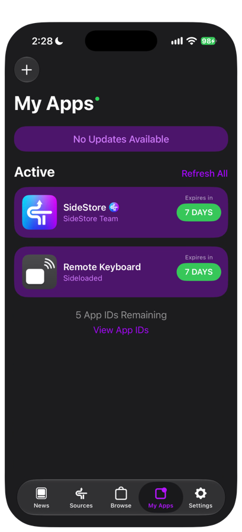
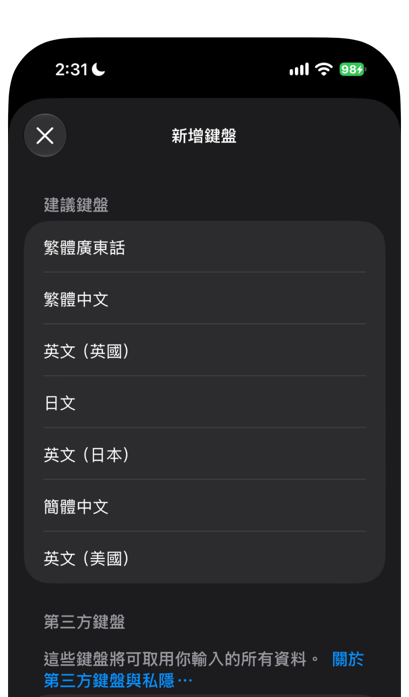
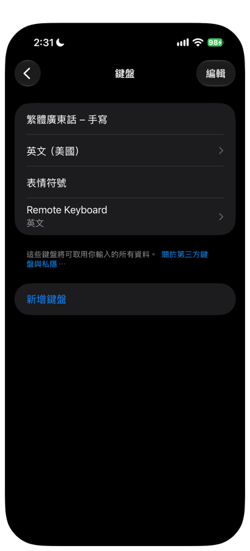
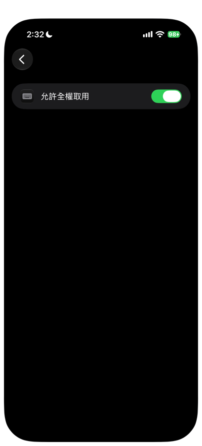
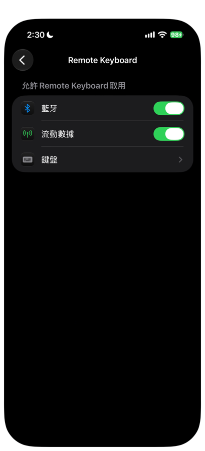
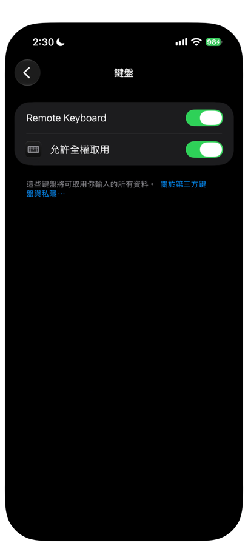
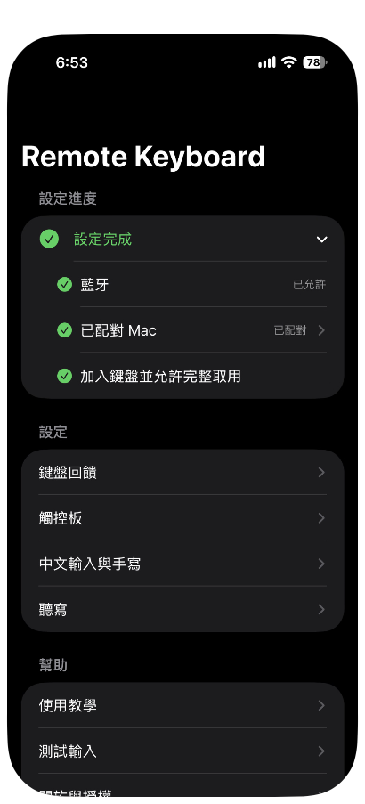
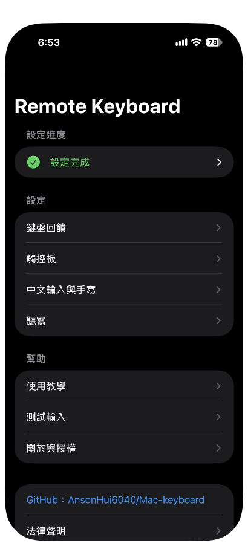

# 03 Install the iPhone app

This chapter uses SideStore to install Remote Keyboard on your iPhone, add the keyboard, and turn on the permissions it needs.

Before you start, make sure SideStore has finished its first refresh (see [02 Install SideStore](02-install-sidestore.md)), your iPhone is on Wi-Fi, and LocalDevVPN shows Connected (已連線).

## 1. Get and verify the IPA

1. On your Mac, download `RemoteKeyboard-vVERSION-unsigned.ipa` from the developer (replace VERSION with the version number, for example 0.1.0), and get the matching SHA-256 value.
2. Open Terminal on your Mac and run the command below. Replace the file path with the location of your IPA.

```bash
shasum -a 256 RemoteKeyboard-vVERSION-unsigned.ipa
```

3. Compare the output with the SHA-256 value from the developer. The two must be exactly the same.
4. Use AirDrop to send that same IPA to your iPhone and save it in the Files app. The file you import later is this verified one.

If the values differ, download the file again. If they still differ after downloading again, report it to the developer and do not install.

## 2. Import the IPA

1. Open SideStore and go to **My Apps**.
2. Tap the "+" at the top left.
3. In the file picker, choose the IPA you just saved.
4. When SideStore asks what to do with the App Extension, choose "Keep App Extensions (Register App ID for Each Extension)".

**Do not choose Remove.** If you remove the Extension, the app no longer contains the keyboard. Keeping the Extension uses 1 extra App ID, so a fresh install uses 2 App IDs in total.

5. Wait for the installation to finish.



When it works, **Remote Keyboard** appears in the Active list of My Apps, and its expiry column shows "7 DAYS". The number of remaining App IDs is shown below the list.

## 3. Add the keyboard

1. Open Settings > General > Keyboard > Keyboards.
2. Tap Add New Keyboard.
3. In the Third-Party Keyboards section, find **Remote Keyboard** and tap it.



4. Go back to the Keyboards page and check that Remote Keyboard is in the list.
5. Tap the **Remote Keyboard** row.



If you do not see Remote Keyboard, the Extension may have been removed during installation. Install the IPA again, and when SideStore asks about the Extension, choose "Keep App Extensions (Register App ID for Each Extension)".

## 4. Allow Full Access

Remote typing, handwriting, and the custom key sound and haptics all need Allow Full Access.

1. On the Remote Keyboard page you opened in the previous step, turn on Allow Full Access. Depending on region and language, iOS may word this setting slightly differently (for example 允許全權取用 in Chinese). The meaning is the same.
2. If a warning appears, read it and tap Allow.



You can also reach the same setting from the Settings app. Scroll to the bottom of Settings (on iOS 18, open Apps first), find **Remote Keyboard**, open it, and tap Keyboards.





When it works, both switches are green.

Turn on Allow Full Access only if you trust where this version came from. The privacy note lists what this permission is used for: see [Privacy note](../../distribution/privacy-note.md) (in Chinese).

## 5. Open the app and allow Bluetooth

1. On the Home Screen, open **Remote Keyboard**.
2. The first time you open it, a four-page guide appears. In order, the pages cover what the app does, installing the Receiver on your Mac, turning on permissions and adding the keyboard, and pairing with your Mac. You can tap Skip (略過) at the top right, or tap Next (下一步) page by page and finish with Done (完成).
3. On the main screen, tap Bluetooth (藍牙) in Setup progress (設定進度) at the top, then tap Allow Bluetooth (允許藍牙).
4. When iOS asks whether Remote Keyboard may use Bluetooth, tap Allow.



When it works, the Bluetooth (藍牙) row gets a check mark. If it shows "Denied, turn it on in Settings" (已拒絕，請到設定開啟), tap Turn on Bluetooth in Settings (到設定開啟藍牙) and turn Bluetooth on there.

The Add the keyboard and Allow Full Access (加入鍵盤並允許完整取用) row gets its check mark only after the keyboard has appeared once with Allow Full Access on. After you finish sections 3 and 4, bring up Remote Keyboard in any text field, then return to the app and you will see the check mark. You can also tap this row to jump to the Remote Keyboard page in the Settings app.

When all three items are done, Setup progress (設定進度) collapses into one green line, Setup complete (設定完成). Tap it to expand and see the three items again.



The main screen has these sections, from top to bottom.

| Section | What it contains |
|---|---|
| Setup progress (設定進度) | Bluetooth (藍牙), Paired Mac (已配對 Mac), and Add the keyboard and Allow Full Access (加入鍵盤並允許完整取用). For the pairing step of Paired Mac (已配對 Mac), see [05 Pairing](05-pairing.md) |
| Settings (設定) | Keyboard feedback (鍵盤回饋), Trackpad (觸控板), Chinese input and handwriting (中文輸入與手寫), and Dictation (聽寫). See [08 App settings](08-app-settings.md) |
| Help (幫助) | Tutorial (使用教學), Test input (測試輸入), and About and licenses (關於與授權) |
| Bottom | The GitHub link, a one-line copyright, and the legal notice |

Next chapter: [04 Install the Mac Receiver](04-install-mac-receiver.md)
