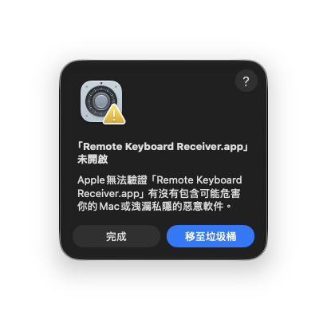
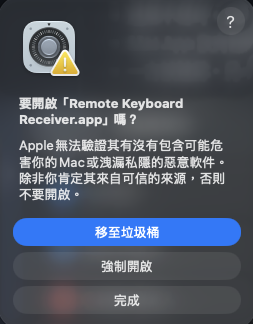
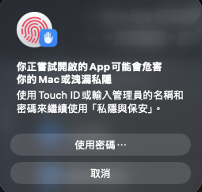
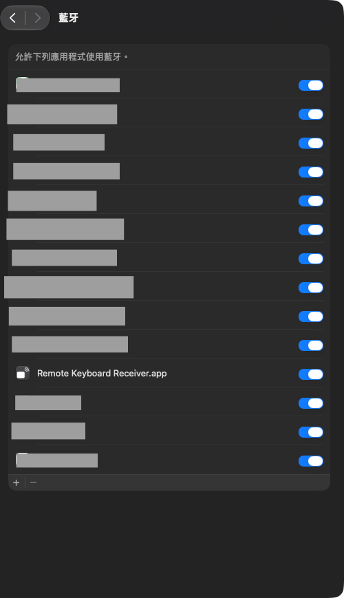
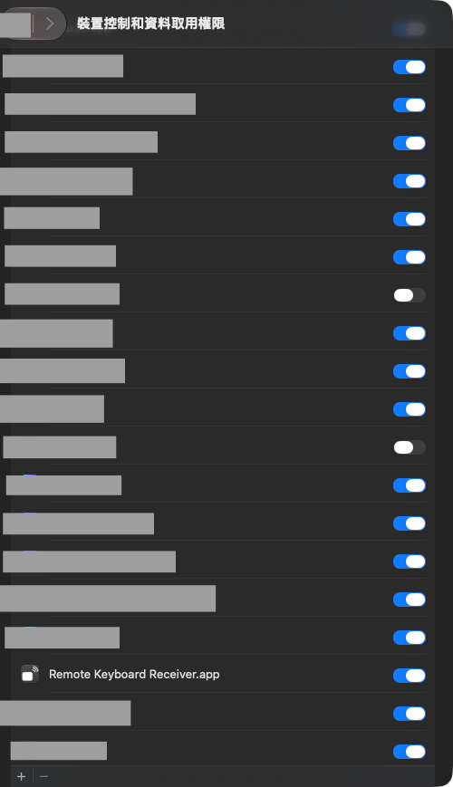
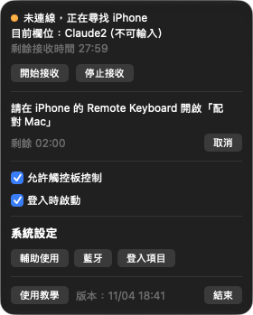
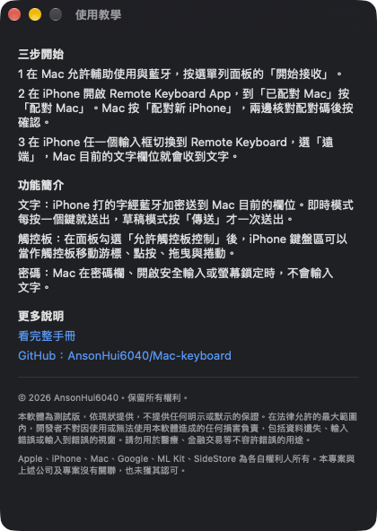

# 04 Install the Mac Receiver

The Mac Receiver is the receiving program you install on your Mac. It types the text and trackpad actions sent from your iPhone into the app you are using on the Mac. It has no Dock icon. It only shows a keyboard icon in the menu bar.

You need macOS 15 or later and a Mac with Apple silicon. This version has not gone through Apple notarization, so macOS blocks it the first time you open it and you need to allow it by hand.

## 1. Download, verify, and install

1. Get `RemoteKeyboardReceiver-vVERSION-macOS.zip` from the developer (replace VERSION with the version number, for example 0.1.0), and the matching SHA-256 value.
2. Open Terminal and run the command below. Replace the file path with the location of your zip file.

```bash
shasum -a 256 RemoteKeyboardReceiver-vVERSION-macOS.zip
```

3. Compare the output with the SHA-256 value from the developer. The two must be exactly the same. If they differ, download the file again and do not install.
4. In Finder, double-click the zip file to unzip it.
5. Drag the unzipped **Remote Keyboard Receiver** into the Applications folder.

## 2. Open it for the first time

The screenshots in this section come from a Mac whose system language is Traditional Chinese (Hong Kong), so the text in them is Chinese. The steps below use the English names that macOS shows.

1. Open **Remote Keyboard Receiver** from Applications.
2. When macOS says it cannot verify the app, click Done to close the message. **Do not click Move to Trash.**



3. Open System Settings > Privacy & Security.
4. Scroll to the Security section at the bottom.
5. Find the line saying "Remote Keyboard Receiver.app" was blocked to protect your Mac, and click Open Anyway on the right. Wording can differ slightly between system languages and older macOS versions.


6. When macOS asks again, click Open Anyway, the middle button. **The blue button is Move to Trash. Do not click it.**



7. Follow the prompt to use Touch ID, or click "Use Password..." and type your Mac password.



When it works, the Receiver opens and a keyboard icon appears in the menu bar at the top right of your Mac.

## 3. Allow Bluetooth

1. The first time you open it, macOS asks whether Remote Keyboard Receiver may use Bluetooth. Click Allow.
2. If you clicked Don't Allow, open System Settings > Privacy & Security > Bluetooth and turn on the switch for Remote Keyboard Receiver. You can also click Bluetooth (藍牙) in the menu bar panel to jump straight to this page.



When it works, the switch is blue and the panel no longer shows red text about Bluetooth.

## 4. Allow Accessibility

The Receiver needs the Accessibility permission to type text into other apps and to tell whether the current field is a password field.

1. Click the keyboard icon in the menu bar to open the menu bar panel.
2. If red text at the top of the panel reads Accessibility is not authorized, cannot type text (尚未授權輔助使用，無法輸入文字), click Authorize Accessibility (授權輔助使用) or Open Accessibility Settings (打開輔助使用設定). These two buttons only appear while the permission has not been granted.
3. In the Accessibility list in System Settings, turn on the switch for **Remote Keyboard Receiver**.
4. If it is not in the list, click the "+" at the bottom left of the list and choose Remote Keyboard Receiver in the Applications folder to add it.
5. If the switch is on but the panel still shows Accessibility is not authorized, cannot type text (尚未授權輔助使用，無法輸入文字), select it in the list and click "-" to remove it, then click "+" to add it again.



Depending on the macOS version, the heading of this list page may read differently.

When it works, the red text in the panel disappears, and the Current field (目前欄位) line shows the name of the app you are in.

## 5. The menu bar panel

Click the keyboard icon in the menu bar to open the panel. The panel contains the following, from top to bottom.



| Item | What it means |
|---|---|
| Red warning | Appears at the top only when something is wrong. If Accessibility is not authorized, it shows Accessibility is not authorized, cannot type text (尚未授權輔助使用，無法輸入文字), with the buttons Authorize Accessibility (授權輔助使用) and Open Accessibility Settings (打開輔助使用設定). If Bluetooth cannot be used, it shows the reason, for example Bluetooth is off, turn it on on your Mac (藍牙已關閉，請在 Mac 開啟藍牙) or Bluetooth is not authorized, allow it in System Settings > Privacy & Security (未授權藍牙，請到系統設定 > 隱私權與安全性 允許), together with the button Open Bluetooth Settings (打開藍牙設定) |
| Connection status (連線狀態) | The first line. Not receiving yet (尚未開始接收) means you have not clicked Start receiving (開始接收). Not connected, looking for iPhone (未連線，正在尋找 iPhone) and Connecting to iPhone (正在連線 iPhone) mean a connection is in progress. Connected (已連線) means the iPhone is connected and you can type. Cannot receive (無法接收) means Bluetooth is not available right now |
| Current field (目前欄位) | Where the Mac is currently typing, for example Current field: TextEdit, can type (目前欄位：文字編輯（可輸入）) or cannot type (（不可輸入）). If Accessibility is not authorized, it shows Cannot read, Accessibility not authorized yet (無法讀取（尚未授權輔助使用）) |
| Receive time left (剩餘接收時間) | A countdown that starts when receiving starts. Receiving stops after 30 minutes of inactivity. When it is not receiving, it shows Standby (待命) |
| Start receiving (開始接收), Stop receiving (停止接收) | Start or stop receiving by hand. If the keyboard cannot connect to your Mac, click Start receiving (開始接收) first |
| Pairing (配對) | Shows Pairing: iPhone paired (配對：已配對 iPhone) or Pairing: not paired (配對：尚未配對), along with Pair new iPhone (配對新 iPhone) and Unpair (解除配對). See [05 Pairing](05-pairing.md). When no iPhone is paired, a three-step hint appears below |
| Allow trackpad control (允許觸控板控制) | When checked, your iPhone can control the Mac cursor. See [07 Trackpad](07-trackpad.md). While the trackpad is in use, Trackpad in use (觸控板使用中) appears below |
| Start at login (登入時啟動) | When checked, the Receiver opens automatically after you log in to the Mac. If it needs to be allowed in System Settings > General > Login Items & Extensions, the panel shows an explanation and the button Open Login Items Settings (打開登入項目設定) |
| System Settings (系統設定) | Three buttons, Accessibility (輔助使用), Bluetooth (藍牙), and Login Items (登入項目), that jump straight to the matching System Settings page |
| Tutorial (使用教學), Version (版本), Quit (結束) | The bottom row. Tutorial (使用教學) opens the tutorial window. Version (版本) shows the build time of this version. Quit (結束) quits the Receiver, and then the keyboard cannot connect to your Mac |

Tutorial (使用教學) opens a separate window. It has a three-step quick start, an overview of the features, and links to the full manual and GitHub, with the copyright and legal notice at the bottom.



When you are done, the Receiver is ready to pair with your iPhone.

Next chapter: [05 Pairing](05-pairing.md)
