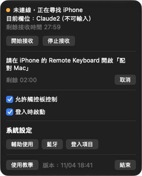
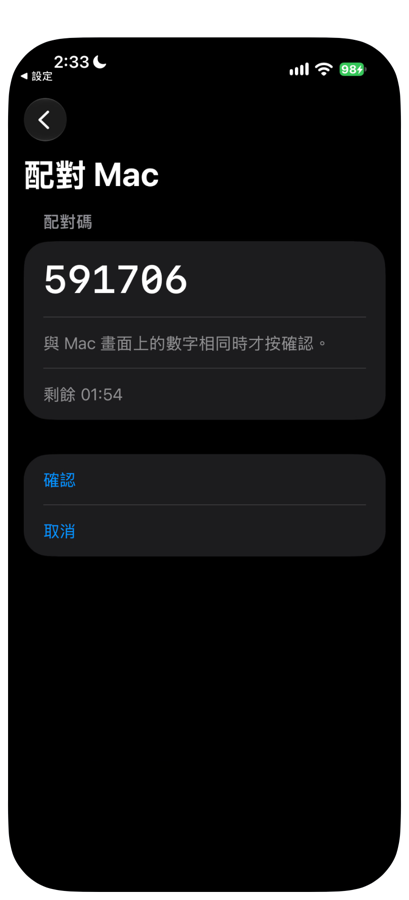
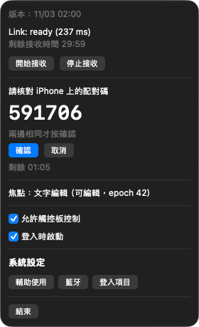
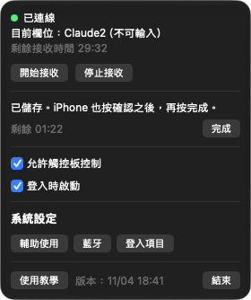
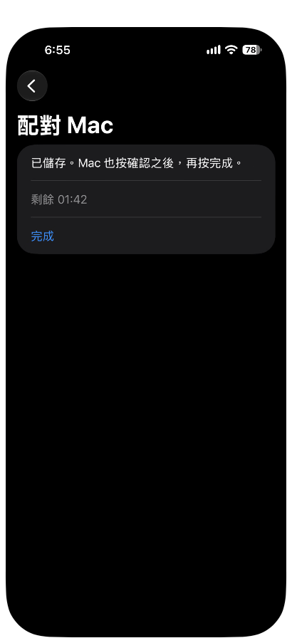
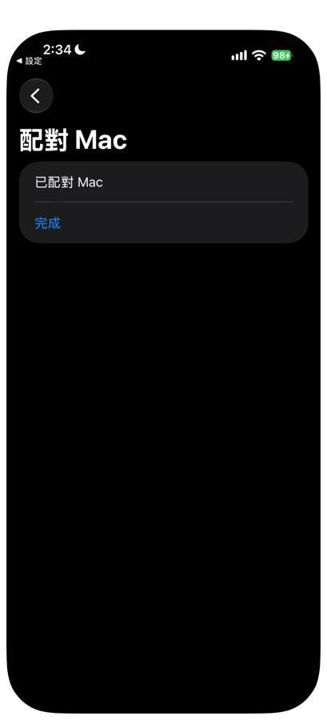
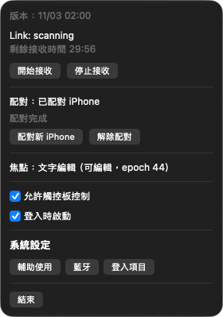

# 05 Pairing

Pairing lets your iPhone and a computer recognize each other. Only a paired iPhone can send text to this computer, so during pairing you check the six-digit pairing code on both screens. You only need to pair once.

This chapter covers the Mac steps first, then the [Windows and Linux pairing steps](#windows-and-linux-pairing-steps). You pair each computer once. An iPhone remembers up to 8 computers, and each computer remembers up to 8 phones.

Before you start, confirm the following:

| Item | Status |
|---|---|
| Mac | Remote Keyboard Receiver is open, and both Bluetooth and Accessibility are allowed (see [04 Install the Mac Receiver](04-install-mac-receiver.md)) |
| iPhone | Remote Keyboard is installed and Bluetooth is allowed (see [03 Install the iPhone app](03-install-iphone-app.md)) |
| Distance | The iPhone is next to the Mac |

In the v0.2 iPhone app, Paired Mac (已配對 Mac) is called Paired computers (已配對電腦) and Pair Mac (配對 Mac) is called Add computer (新增電腦). The Mac steps and screenshots below still use the old names. The buttons are in the same places.

Pairing has a time limit. The screen shows a countdown labeled Time left, mm:ss (剩餘 mm:ss). If you do not finish in time, it shows Pairing timed out, not saved (配對逾時，未儲存). Just start again.

## Pairing steps

1. On the Mac, click the keyboard icon in the menu bar to open the menu bar panel.
2. Click Pair new iPhone (配對新 iPhone). The panel shows On your iPhone, open "Pair Mac" in Remote Keyboard (請在 iPhone 的 Remote Keyboard 開啟「配對 Mac」) and starts the countdown.

3. On the iPhone, open **Remote Keyboard**.
4. At the top, under Setup progress (設定進度), tap Paired Mac (已配對 Mac). Before pairing, this row shows Not paired (尚未配對). If all three items are done and only one line, Setup complete (設定完成), is left, tap Setup complete (設定完成) first to expand it.
5. On the Paired Mac (已配對 Mac) page, tap Pair Mac (配對 Mac). The screen shows In the Mac's menu bar app, click "Pair new iPhone". This screen connects automatically. (在 Mac 的選單列 App 按「配對新 iPhone」，這個畫面會自動連上。) Within a few seconds it connects to the Mac by itself.

Once connected, both screens show the same six-digit pairing code.

6. On the iPhone and the Mac, check that the six digits on both screens are exactly the same.

7. If the digits match, click Confirm (確認) on the Mac.
8. Tap Confirm (確認) on the iPhone.

If the digits do not match, do not confirm. Click or tap Cancel (取消) on both devices, then start again from step 1.

9. Each device shows Saved (已儲存). The Mac shows Saved. After the iPhone also confirms, click Done. (已儲存。iPhone 也按確認之後，再按完成。) The iPhone shows Saved. After the Mac also confirms, tap Done. (已儲存。Mac 也按確認之後，再按完成。)

10. Click Done (完成) on the Mac.
11. Tap Done (完成) on the iPhone.

You can only click or tap Done (完成) after both devices have confirmed.

When it works, the Paired Mac (已配對 Mac) page on the iPhone shows Paired Mac (已配對 Mac), and the menu bar panel shows Pairing: iPhone paired (配對：已配對 iPhone) and Pairing complete (配對完成).

## Windows and Linux pairing steps

Before you start, make sure the receiver is installed and running (see [04b Install the Windows receiver](04b-install-windows-receiver.md) or [04c Install the Linux receiver](04c-install-linux-receiver.md)), Bluetooth is on for the computer, and the iPhone is next to it. The pairing window lasts 120 seconds.

1. In the computer's tray menu, choose Pair a new phone (配對新手機). The first line of the menu changes to "Pairing: open the pairing screen on the phone" (配對中，請在手機上開啟配對畫面). The item cannot be clicked while receiving is stopped, so choose Start receiving (開始接收) first.
2. On the iPhone, open **Remote Keyboard**, go to Setup progress (設定進度) at the top, tap Paired computers (已配對電腦), then tap Add computer (新增電腦). The screen shows On the computer's receiver menu, click "Pair new iPhone" (Windows and Linux: "Pair a new phone"). This screen connects automatically. (在電腦的接收端選單按「配對新 iPhone」（Windows、Linux 為「配對新手機」），這個畫面會自動連上。) Within a few seconds it connects to the computer.
3. Once connected, the iPhone shows Computer to pair (要配對的電腦, the computer's name and platform) and a six-digit Pairing code (配對碼). The computer opens a dialog at the same time, showing the phone's name and the same code:

| System | Dialog | Buttons |
|---|---|---|
| Windows | Title "Remote Keyboard". Text: Phone "phone name" wants to pair. Pairing code: six digits. Does the phone show the same code? (手機「手機名稱」要求配對。配對碼：六位數字。手機上顯示的配對碼相同嗎？) | Yes and No (是、否), in the Windows display language |
| Linux | Title "Pair a new phone" (配對新手機). Same text | Same code (相符) and Different (不相符) in English, 相符 and 不相符 in Chinese |

4. Check that the six digits on the iPhone and in the computer's dialog are exactly the same. If they match, choose Yes (Windows) or Same code (Linux) on the computer, and tap Confirm (確認) on the iPhone. If they differ, choose No or Different on the computer, tap Cancel (取消) on the iPhone, and start again from step 1.
5. The iPhone shows Saved. After the computer also confirms, tap Done. (已儲存。電腦也按確認之後，再按完成。) Tap Done (完成). The computer has no Done button. It is finished once you have chosen Yes or Same code.

The computer's dialog closes by itself if the connection ends or the pairing window runs out.

When it works, the Paired computers (已配對電腦) page on the iPhone lists this computer, and the Paired phones (已配對的手機) list in the computer's tray menu shows this phone. For failure messages on the computer, see the tooltip tables in 04b or 04c.

## Messages when pairing fails

| Where | Message | What to do |
|---|---|---|
| iPhone | Bluetooth is off. Turn it on and try again (藍牙未開啟，請開啟後再試) | Turn on Bluetooth on the iPhone and try again |
| iPhone | Bluetooth is not allowed. Turn it on in Settings (尚未允許藍牙，請到設定開啟) | Tap Turn on Bluetooth in Settings (到設定開啟藍牙), turn Bluetooth on, then come back and try again |
| iPhone | Pairing timed out, not saved (配對逾時，未儲存) | Start again from step 1 |
| iPhone | The Mac canceled or the connection dropped, not saved (Mac 已取消或連線中斷，未儲存) | Make sure the Mac did not cancel, then start again |
| iPhone | Pairing failed, not saved (配對失敗，未儲存) | Start again |
| iPhone | Could not save the pairing. Try again (無法儲存配對，請再試一次) | Tap Retry (重試), or start again |
| Mac | Could not save the pairing. Try again (無法儲存配對，請再試一次) | Click Pair new iPhone (配對新 iPhone) again |
| iPhone | Could not start pairing. Try again (無法開始配對，請再試一次) | Tap Retry (重試). If that does not help, close the app and open it again |
| Mac | Pairing failed, not saved (配對失敗，未儲存) | Start again |
| Mac | Pairing canceled (配對已取消) | Start again |

For Bluetooth failures, first check that the top of the menu bar panel shows no red explanation text.

## Re-pairing and unpairing

| Situation | What to do |
|---|---|
| The keyboard shows Pairing verification failed (配對驗證失敗), or you want to switch to another iPhone | Pair again on both devices: click Pair new iPhone (配對新 iPhone) on the Mac, tap Pair Mac (配對 Mac) on the iPhone, check the pairing code, click or tap Confirm (確認) on both, then finish with Done (完成) |
| You want to remove this pairing | On the menu bar panel, click Unpair (解除配對). On the iPhone, open Setup progress > Paired Mac (設定進度 > 已配對 Mac) and tap Unpair (解除配對). On Windows and Linux, open Paired phones (已配對的手機) in the tray menu, pick the phone and choose Delete (刪除) |

After you unpair, the iPhone keyboard shows Not paired (尚未配對) in Remote (遠端) mode. You need to pair again before you can send text.

## After an update

| What you updated | Pairing | What you need to do |
|---|---|---|
| Mac Receiver (updates after v0.2) | Kept, no need to pair again | Allow Accessibility again, see [04 Install the Mac Receiver](04-install-mac-receiver.md) |
| iPhone app (updates after v0.2) | Kept if it is signed with the same Apple Account | Open the app and check that Paired Mac (已配對 Mac) under Setup progress (設定進度) shows Paired (已配對) |
| Windows or Linux receiver (updates after v0.2) | Kept, no need to pair again | Nothing to do |
| Update from v0.1 to v0.2 | Not kept | The protocol moved to v4 and does not work with v0.1. Update the iPhone app and the Mac Receiver, and pair every computer again |

For the full update steps, see [09 Refresh and update](09-refresh-and-update.md).

Next chapter: [06 Using the keyboard](06-using-the-keyboard.md)
