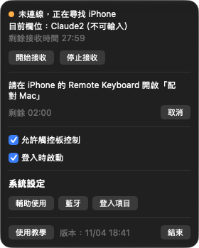
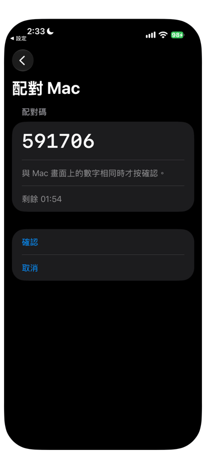
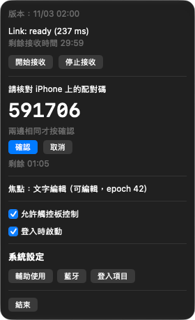
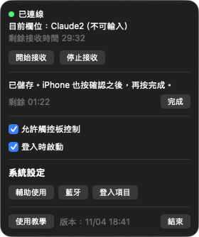
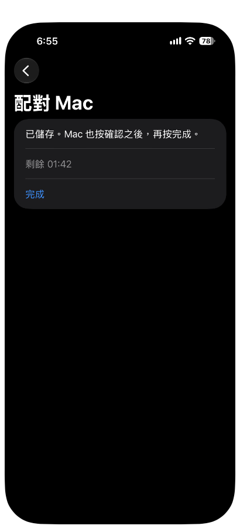
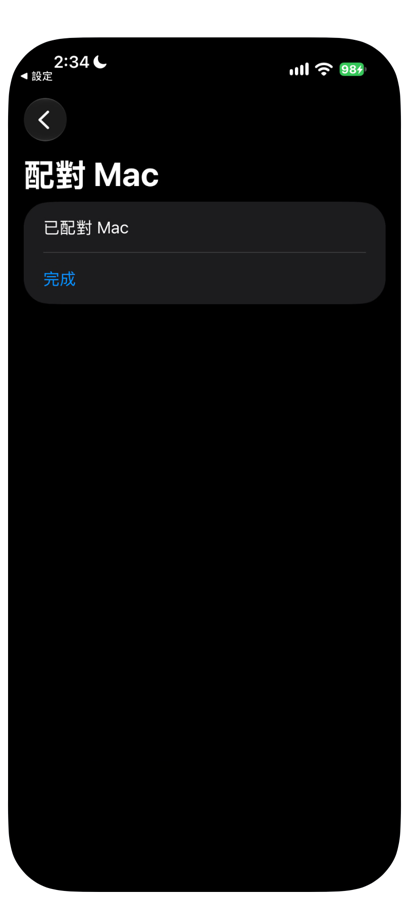
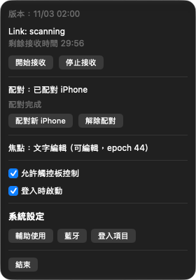

# 05 Pairing

Pairing lets your iPhone and Mac recognize each other. Only a paired iPhone can send text to this Mac, so during pairing you check the six-digit pairing code on both screens. You only need to pair once.

Before you start, confirm the following:

| Item | Status |
|---|---|
| Mac | Remote Keyboard Receiver is open, and both Bluetooth and Accessibility are allowed (see [04 Install the Mac Receiver](04-install-mac-receiver.md)) |
| iPhone | Remote Keyboard is installed and Bluetooth is allowed (see [03 Install the iPhone app](03-install-iphone-app.md)) |
| Distance | The iPhone is next to the Mac |

Pairing has a time limit. The screen shows a countdown labeled 「剩餘 mm:ss」 (Time left, mm:ss). If you do not finish in time, it shows 「配對逾時，未儲存」 (Pairing timed out, not saved). Just start again.

## Pairing steps

1. On the Mac, click the keyboard icon in the menu bar to open the Receiver panel.
2. Click 「配對新 iPhone」 (Pair new iPhone). The panel shows 「請在 iPhone 的 Remote Keyboard 開啟「配對 Mac」」 (On your iPhone, open "Pair Mac" in Remote Keyboard) and starts the countdown.

3. On the iPhone, open **Remote Keyboard**.
4. At the top, under 「設定進度」 (Setup progress), tap 「已配對 Mac」 (Paired Mac). Before pairing, this row shows 「尚未配對」 (Not paired). If all three items are done and only one line, 「設定完成」 (Setup complete), is left, tap 「設定完成」 first to expand it.
5. On the 「已配對 Mac」 page, tap 「配對 Mac」 (Pair Mac). The screen shows 「在 Mac 的選單列 App 按「配對新 iPhone」，這個畫面會自動連上。」 (In the Mac's menu bar app, click "Pair new iPhone". This screen connects automatically.) Within a few seconds it connects to the Mac by itself.

Once connected, both screens show the same six-digit pairing code.

6. On the iPhone and the Mac, check that the six digits on both screens are exactly the same.

7. If the digits match, click 「確認」 (Confirm) on the Mac.
8. Tap 「確認」 (Confirm) on the iPhone.

If the digits do not match, do not confirm. Click or tap 「取消」 (Cancel) on both devices, then start again from step 1.

9. Each device shows 「已儲存」 (Saved). The Mac shows 「已儲存。iPhone 也按確認之後，再按完成。」 (Saved. After the iPhone also confirms, click Done.) The iPhone shows 「已儲存。Mac 也按確認之後，再按完成。」 (Saved. After the Mac also confirms, tap Done.)

10. Click 「完成」 (Done) on the Mac.
11. Tap 「完成」 (Done) on the iPhone.

You can only click or tap 「完成」 after both devices have confirmed.

When it works, the 「已配對 Mac」 page on the iPhone shows 「已配對 Mac」 (Paired Mac), and the Mac panel shows 「配對：已配對 iPhone」 (Pairing: iPhone paired) and 「配對完成」 (Pairing complete).

## Messages when pairing fails

| Where | Message | What to do |
|---|---|---|
| iPhone | 藍牙未開啟，請開啟後再試 (Bluetooth is off. Turn it on and try again) | Turn on Bluetooth on the iPhone and try again |
| iPhone | 尚未允許藍牙，請到設定開啟 (Bluetooth is not allowed. Turn it on in Settings) | Tap 「到設定開啟藍牙」 (Turn on Bluetooth in Settings), turn Bluetooth on, then come back and try again |
| iPhone | 配對逾時，未儲存 (Pairing timed out, not saved) | Start again from step 1 |
| iPhone | Mac 已取消或連線中斷，未儲存 (The Mac canceled or the connection dropped, not saved) | Make sure the Mac did not cancel, then start again |
| iPhone | 配對失敗，未儲存 (Pairing failed, not saved) | Start again |
| iPhone | 無法儲存配對，請再試一次 (Could not save the pairing. Try again) | Tap 「重試」 (Retry), or start again |
| Mac | 無法儲存配對，請再試一次 (Could not save the pairing. Try again) | Click 「配對新 iPhone」 again |
| iPhone | 無法開始配對，請再試一次 (Could not start pairing. Try again) | Tap 「重試」 (Retry). If that does not help, close the app and open it again |
| Mac | 配對失敗，未儲存 (Pairing failed, not saved) | Start again |
| Mac | 配對已取消 (Pairing canceled) | Start again |

For Bluetooth failures, first check that the top of the Mac panel shows no red explanation text.

## Re-pairing and unpairing

| Situation | What to do |
|---|---|
| The keyboard shows 「配對驗證失敗」 (Pairing verification failed), or you want to switch to another iPhone | Pair again on both devices: click 「配對新 iPhone」 on the Mac, tap 「配對 Mac」 on the iPhone, check the pairing code, click or tap 「確認」 on both, then finish with 「完成」 |
| You want to remove this pairing | On the Mac panel, click 「解除配對」 (Unpair). On the iPhone, open 「設定進度 > 已配對 Mac」 (Setup progress > Paired Mac) and tap 「解除配對」 |

After you unpair, the iPhone keyboard shows 「尚未配對」 (Not paired) in Remote mode. You need to pair again before you can send text.

## After an update

| What you updated | Pairing | What you need to do |
|---|---|---|
| Mac Receiver | Kept, no need to pair again | Allow Accessibility again, see [04 Install the Mac Receiver](04-install-mac-receiver.md) |
| iPhone app | Kept if it is signed with the same Apple Account | Open the app and check that 「已配對 Mac」 under 「設定進度」 shows 「已配對」 (Paired) |

For the full update steps, see [09 Refresh and update](09-refresh-and-update.md).

Next chapter: [06 Using the keyboard](../06-using-the-keyboard.md) (in Chinese)
