# 06 Using the keyboard

This chapter explains how to type with Remote Keyboard, including English, symbols, handwriting (手寫) and Quick (速成), and what the various messages above the keyboard mean.

Before you start, confirm that you have finished pairing (see [05 Pairing](05-pairing.md)), that the Receiver on the Mac is open, and that the cursor on the Mac is in a text field, for example in a TextEdit document.

## Switch to Remote Keyboard

1. Tap any text field on the iPhone to bring up the keyboard. You can use Test input (測試輸入) under Help (幫助) on the Remote Keyboard main screen.
2. Press and hold the globe key at the bottom left of the keyboard, then choose **Remote Keyboard** from the list. You can also tap the globe key repeatedly to cycle through your keyboards.

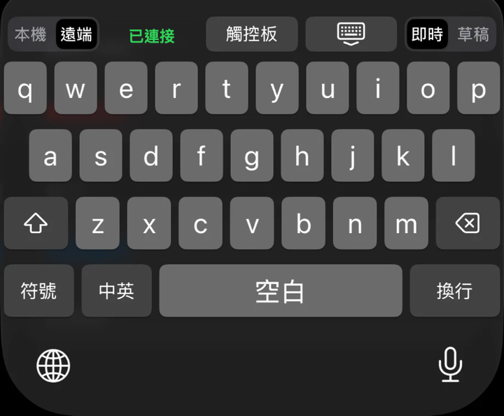

When it works, the Local (本機) and Remote (遠端) switch appears above the keyboard. With Remote (遠端) selected and the Mac connected, the middle shows a green Connected (已連接).

## Top bar

| Position | Item | What it does |
|---|---|---|
| Far left | Local (本機), Remote (遠端) | Decides where the text goes |
| Left of center | Status text | Shows the connection and the state of the Mac, see "The status line" below |
| Right of center | Trackpad (觸控板) | Switches to the trackpad, see [07 Trackpad](07-trackpad.md). It is gray and cannot be tapped when the iPhone is not connected to the Mac |
| Right of center | The key with a keyboard and a down arrow | Hides the keyboard |
| Far right | Live (即時), Draft (草稿) | Decides when the text is sent |

## Local (本機) and Remote (遠端)

| Choice | Where the text goes |
|---|---|
| Local (本機) | Typed directly into the app that is open on the iPhone. Nothing goes to the Mac |
| Remote (遠端) | Sent to the paired Mac over encrypted Bluetooth and typed into the field the Mac is currently in |

With Local (本機) selected, the top bar shows only the switch and the hide keyboard key. There is no status text, no Trackpad (觸控板), and no Live (即時) and Draft (草稿).

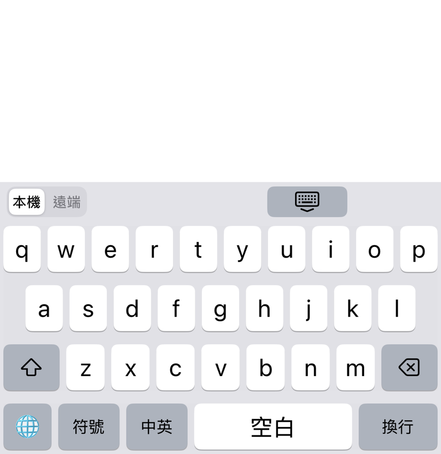

## Live (即時) and Draft (草稿)

In Remote (遠端) mode you can choose how the text is sent.

| Choice | How it works | Best for |
|---|---|---|
| Live (即時) | Each key you press appears on the Mac right away | Everyday typing |
| Draft (草稿) | You edit in the draft bar above the keyboard, and the text goes to the Mac all at once when you press Send (傳送) | Checking or editing before you send |

### The draft bar

After you choose Draft (草稿), a draft bar appears below the top bar.

| Item | What it does |
|---|---|
| Left and right arrow keys | Move the cursor in the draft one step left or right |
| Draft text | Tap the text and the cursor moves to where your finger is. Press and drag left or right and the cursor moves continuously. Whatever you type next is inserted at the cursor |
| Send (傳送) | Sends the draft to the Mac and clears the draft bar |

When the draft is empty, the draft bar shows Type a draft (輸入草稿).

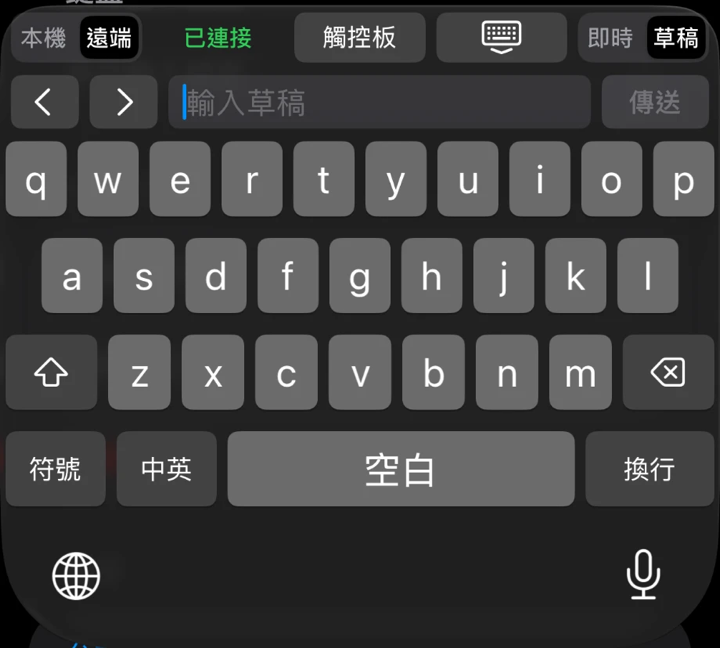

When it works, after you press Send (傳送), the text from the draft appears in the field the Mac is currently in.

## English

The default page is the English keyboard.

| Key | What it does |
|---|---|
| Shift key | Three states: off, capitalize the next letter, and caps lock |
| Delete key | Tap once to delete one character. Press and hold to keep deleting |
| Space (空白) | The space bar |
| Return (換行) | Starts a new line |
| Globe key | Switches to the next keyboard |

## Symbols (符號)

1. Tap Symbols (符號) at the bottom left to switch to the numbers and symbols page.
2. When you need more symbols, tap #+= on the left to switch the symbol layer.
3. Tap ABC to go back to the English letters page. If you got to the symbols page from the Chinese page, this key shows 中 instead, and tapping it returns you to the Chinese page.

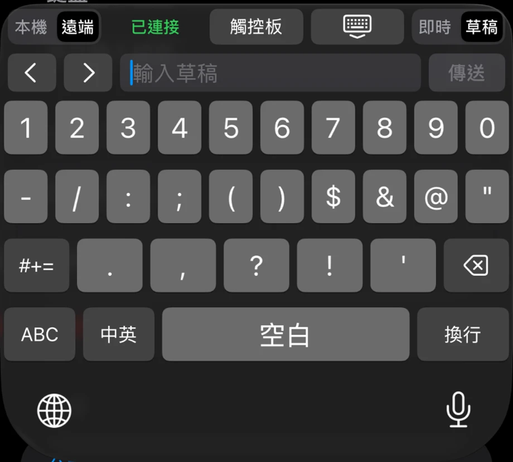

## Chinese

Tap Chinese/English (中英) to switch between Chinese and English. Which input method the Chinese page uses is set in Chinese input and handwriting (中文輸入與手寫) in the app (see [08 App settings](08-app-settings.md)). You can choose handwriting (手寫) or Quick (速成).

### Handwriting (手寫)

Handwriting needs the handwriting model to be downloaded first in Chinese input and handwriting (中文輸入與手寫) in the app, and Allow Full Access turned on. Without Full Access, the Chinese page uses Quick (速成) instead.

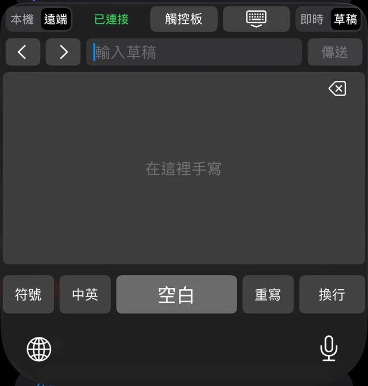

1. Write one character in the writing area with your finger.
2. Candidate characters appear above the writing area. Swipe left to see more.
3. Tap the character you want and it is typed.
4. If you write it wrong, tap Rewrite (重寫) at the bottom right to clear the writing area. The delete key at the far right of the candidate bar deletes characters you have already typed.

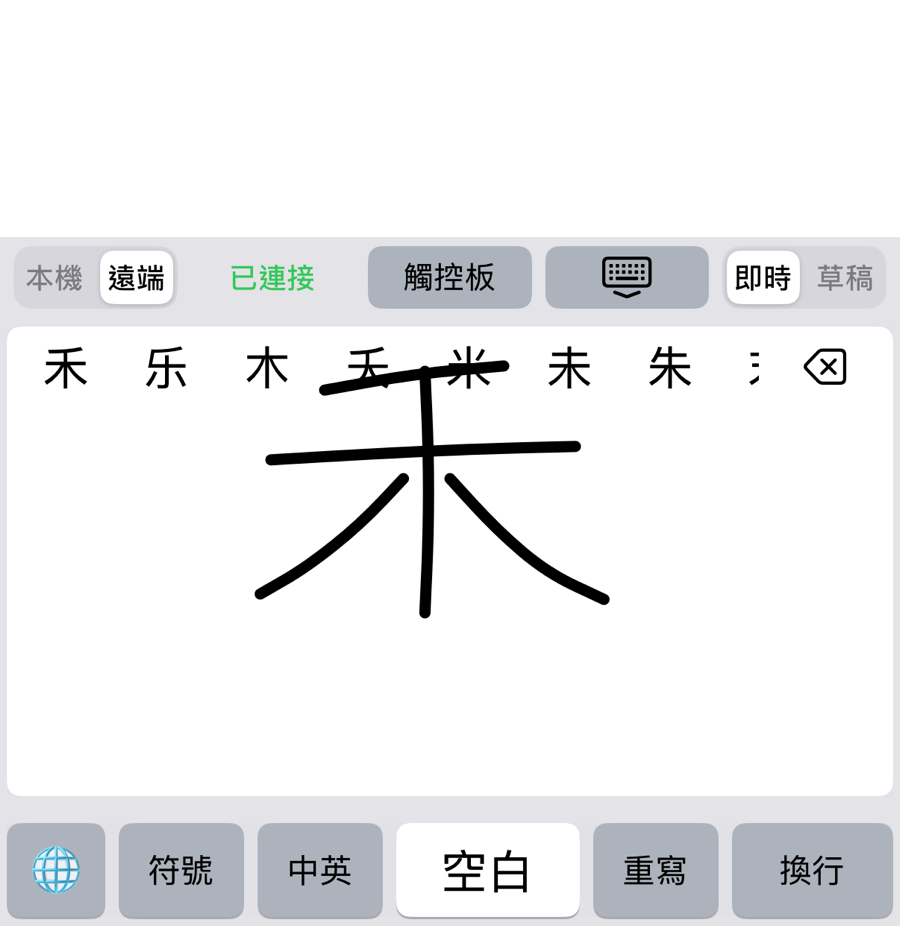

The bottom row has Symbols (符號), Chinese/English (中英), Space (空白), Rewrite (重寫) and Return (換行).

### Quick (速成)

The Quick (速成) page has the same key positions as the English page. The main character on each key is the radical, and the small letter at the top right is the matching English letter.

1. Press the radical keys following the Quick (速成) rules.
2. The input code appears in blue at the far left of the candidate bar, followed by the candidate characters.
3. Tap a candidate character to type it. The first candidate has a light background, and pressing Space (空白) types it directly.

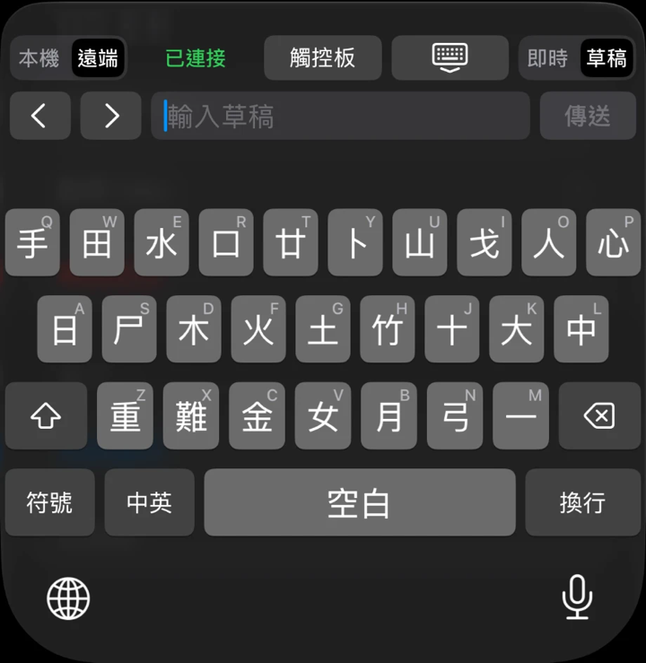

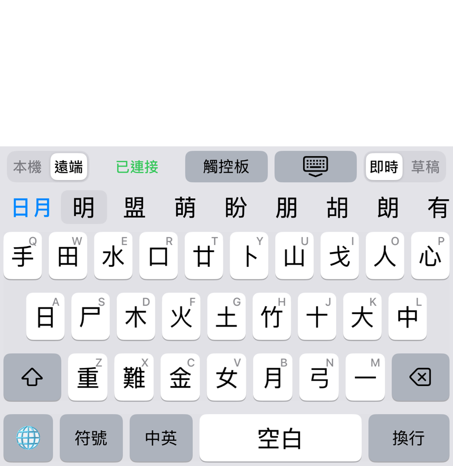

## Hide the keyboard

Tap the key with the down arrow, just right of the middle of the top bar, to hide the keyboard.

## The status line

In Remote (遠端) mode, the status text is to the right of the Local (本機) and Remote (遠端) switch. Green means normal. Red means you need to do something.

| Text | What it means | What to do |
|---|---|---|
| Connected (已連接) | Connected to the Mac and ready to type | Nothing |
| Not connected (未連接) | The iPhone cannot find or reach the Mac | See "Not connected (未連接)" below |
| Not paired (尚未配對) | This iPhone has not been paired with the Mac | Open Remote Keyboard and pair following [05 Pairing](05-pairing.md). The Trackpad (觸控板) does not work while not paired either |
| password entry blocked (密碼不能輸入) | The Mac is in a password field, Secure Input is on, or the screen is locked | See "How passwords are handled" below |
| Mac not authorized for Accessibility (Mac 未授權輔助使用) | The Receiver on the Mac does not have Accessibility permission yet | On the Mac, allow it following [04 Install the Mac Receiver](04-install-mac-receiver.md) |

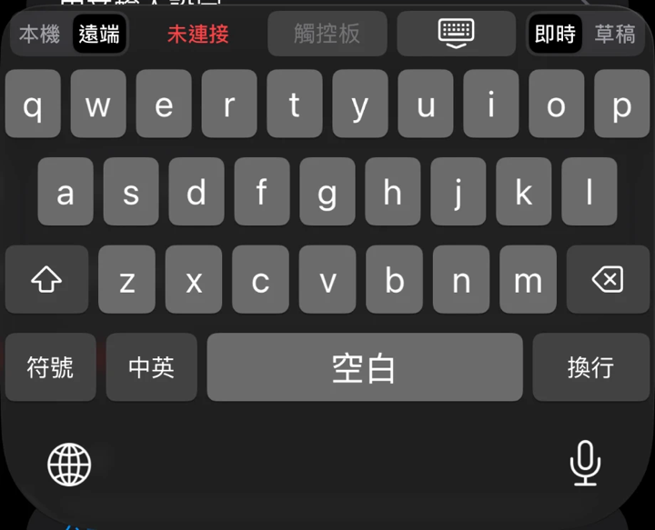

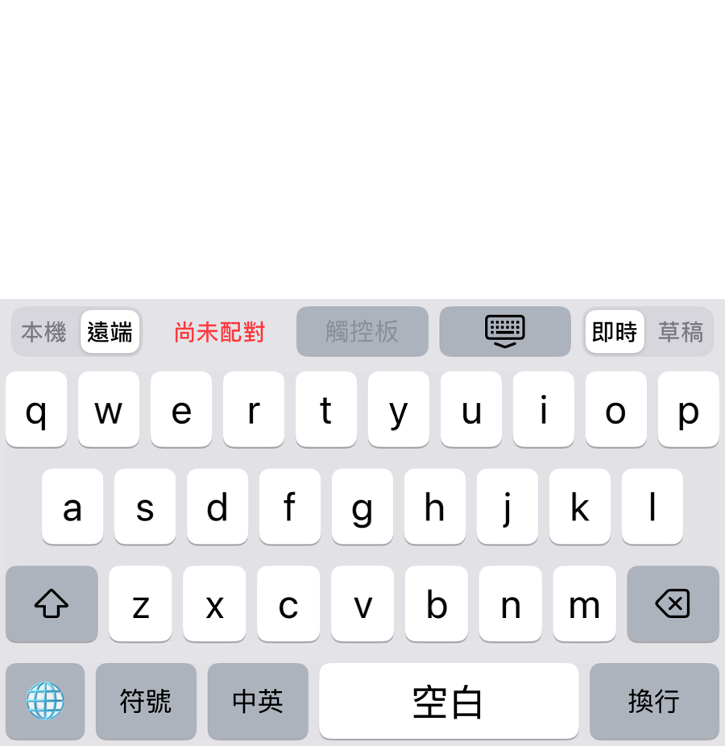

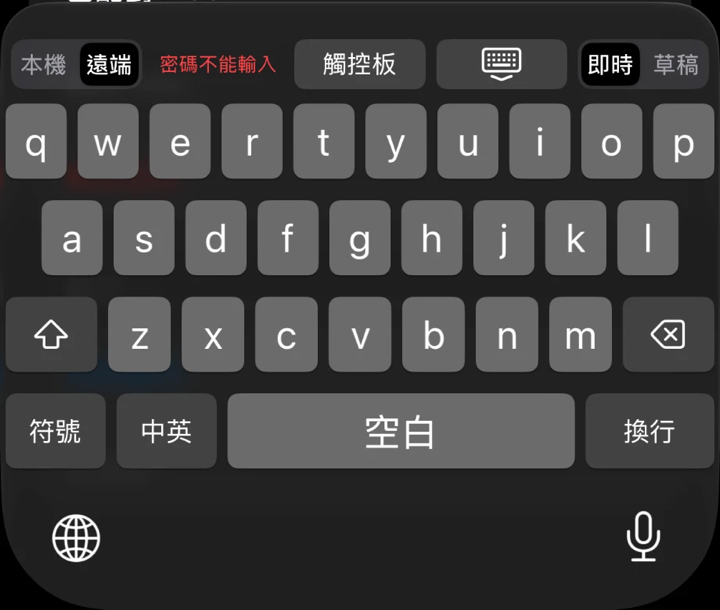

### Not connected (未連接)

1. Make sure the Receiver on the Mac is open and that the connection status on its panel is Connected (已連線) or Not connected, looking for iPhone (未連線，正在尋找 iPhone).
2. On the Mac, click a text field, or open the Receiver from the menu bar and click Start receiving (開始接收). The Receiver stops receiving after 30 minutes of idle time.
3. Make sure Bluetooth is on for both the iPhone and the Mac.
4. Hide the keyboard and bring it up again. The keyboard reconnects automatically.

### Notice messages

If text you type does not reach the Mac, the status line briefly shows a notice in red.

| Notice | What it means | What to do |
|---|---|---|
| Mac has no input field, not entered (Mac 沒有輸入欄位，未輸入) | The Mac is not in a text field, for example it is on the Finder desktop | Click the text field you want to type in on the Mac, then type again |
| Mac not connected, not entered (Mac 未連接，未輸入) | The connection dropped while you were typing | See "Not connected (未連接)" above, then type again |
| Mac not ready, not entered (Mac 尚未就緒，未輸入) | You just connected and the Mac has not reported its state yet | Wait a moment, then type |
| Focus changed, not entered (焦點已改變，未輸入) | The Mac switched windows or fields while you were typing | Check which field the Mac is in now, then type again |
| Mac is composing text, not entered (Mac 正在組字，未輸入) | The input method on the Mac is in the middle of composing | Finish or cancel the composition on the Mac, then type again |
| Input method switch failed (輸入法切換失敗) | The Mac could not switch to English input automatically | Switch to an English input method on the Mac yourself, then type again |
| Mac input failed, Mac cannot process it, wrong order, not entered (Mac 輸入失敗、Mac 無法處理、順序錯誤，未輸入) | This attempt to type did not succeed | Type again. If it keeps appearing, quit the Receiver and open it again |
| N keys not confirmed as delivered (N 個按鍵未確認是否送達), where N is a number | The connection dropped and some keys did not get a confirmation from the Mac | Check the text on the Mac, then add what is missing or delete what is duplicated |

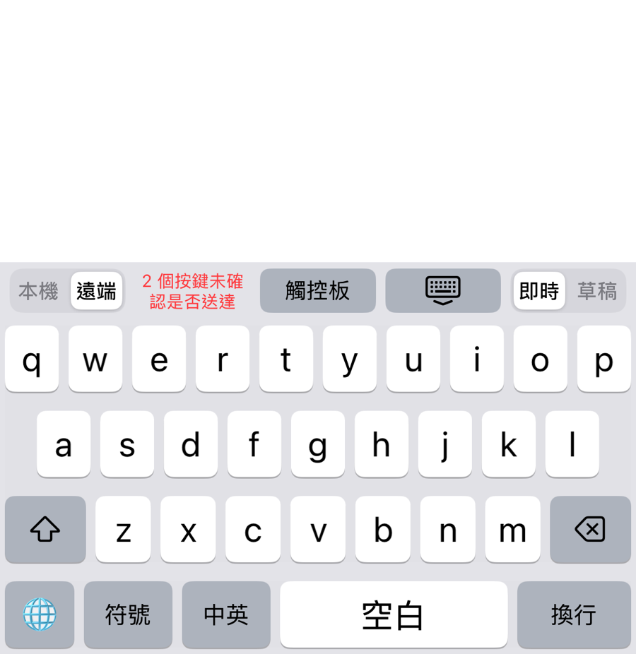

When the connection is unstable, text can go missing or be duplicated. Check important text once more before you send it.

## How passwords are handled

For safety, in the following cases the Receiver on the Mac does not type text, and the keyboard shows password entry blocked (密碼不能輸入).

| Case | Details |
|---|---|
| Password field | The cursor is in a field the system marks as a password field |
| Secure Input | An app has turned on Secure Input, for example Secure Keyboard Entry in Terminal |
| Locked screen | The Mac's screen is locked |

In these cases the two sending modes behave as follows.

| Sending mode | What happens |
|---|---|
| Live (即時) | The text you type is not sent and is not kept |
| Draft (草稿) | Text and new lines are discarded. The delete key and the cursor still work. Send (傳送) is refused by the Mac, so no text goes into the password field |

Text you type while the Mac is locked is not sent after you unlock it.

### Another app left Secure Input on

When another app forgets to turn off Secure Input, ordinary fields also show password entry blocked (密碼不能輸入). It goes back to normal once you turn off Secure Input in that app. Common causes:

1. Terminal has Secure Keyboard Entry turned on.
2. A browser still has a tab sitting on a password field. Close those tabs.

### What it cannot detect

This protection only covers fields that the system marks as password fields. The following cases cannot be detected, and the text is still sent:

| Case | Details |
|---|---|
| Password prompts such as sudo or ssh in other terminal apps | Apple's Terminal on macOS 27.2 blocked the text while input was hidden. Other terminal apps and other system versions have not been verified |
| Password fields inside a remote desktop or virtual machine window | Cannot be detected |
| Input boxes an app draws itself and does not mark as password fields | Cannot be detected |

**Do not use this keyboard to type passwords.** For details, see the [Privacy note](../../distribution/privacy-note.md) (in Chinese).

Next chapter: [07 Trackpad](07-trackpad.md)
