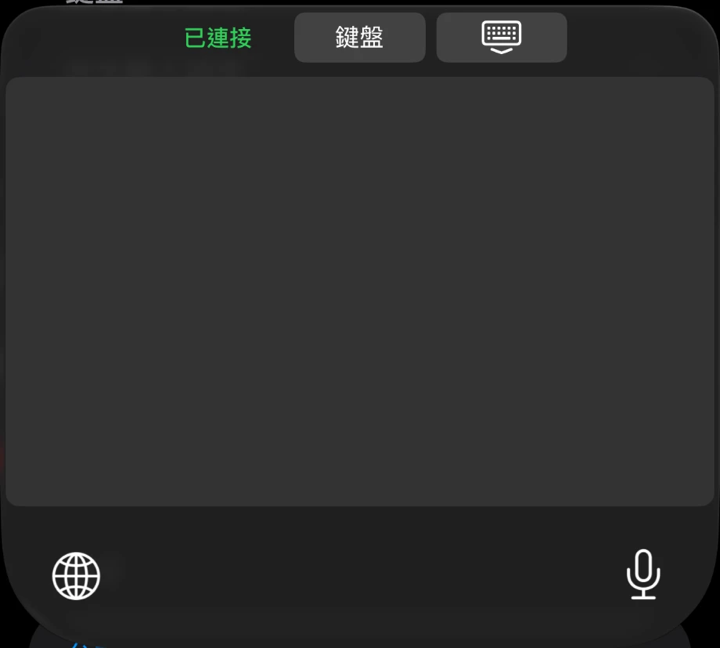
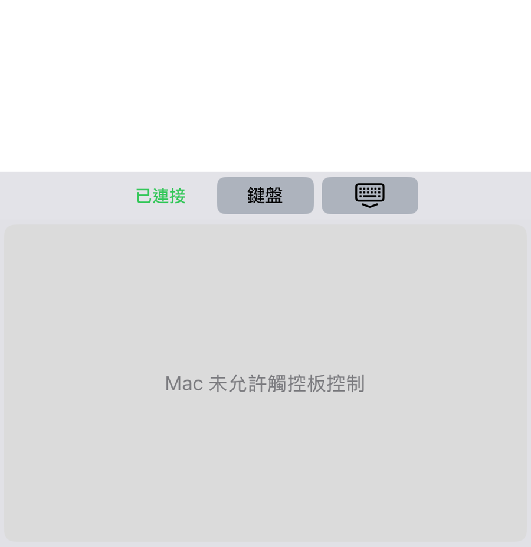

# 07 Trackpad

Trackpad mode turns the keyboard area of your iPhone into a trackpad for your Mac. You can move the cursor, click, drag, and scroll.

You need the following before you start:

| Item | Details |
|---|---|
| Pairing | The iPhone and Mac are paired (see [05 Pairing](05-pairing.md)) |
| Connection | The keyboard is in Remote (遠端) mode, and the keyboard's status line shows Connected (已連接) |
| Mac setting | Allow trackpad control (允許觸控板控制) is checked in the menu bar panel |
| Accessibility | The Mac Receiver has the Accessibility permission (see [04 Install the Mac Receiver](04-install-mac-receiver.md)) |

## Turn the trackpad on and off

1. On the Mac, click the keyboard icon in the menu bar and make sure Allow trackpad control (允許觸控板控制) is checked.
2. On the iPhone, bring up Remote Keyboard and choose Remote (遠端).
3. Tap Trackpad (觸控板) in the top bar.
4. The keyboard area becomes one large gray trackpad.

5. To go back to typing, tap Keyboard (鍵盤) in the top bar.

When it works, you move a finger in the gray area and the Mac cursor follows.

## Gestures

| Action | Gesture |
|---|---|
| Move the cursor | Slide one finger on the trackpad |
| Click (left click) | Tap once quickly with one finger |
| Double-click | Tap twice quickly, both taps in about the same spot |
| Right-click | Tap once quickly with two fingers at the same time |
| Drag (method 1) | Tap once, then right away touch down with the same finger and hold, then move. Lift your finger to let go |
| Drag (method 2) | Hold one finger still for about 0.4 seconds, then move. Lift your finger to let go |
| Scroll | Slide two fingers together up, down, left, or right |

A few tips:

| Tip | Details |
|---|---|
| Tap quickly | If your finger stays down too long, it does not count as a tap |
| Do not move while you tap | If your finger slides even a little, it becomes cursor movement and does not click |
| Dragging | For method 1, the second touch has to come soon after the tap. If you hold it or start moving, it becomes a drag and not a double-click |
| Scrolling | Lifting either finger ends that scroll |

You can adjust the trackpad's sensitivity (靈敏度) and send rate (傳輸次數) under Trackpad (觸控板) in the app, see [08 App settings](08-app-settings.md).

## If the trackpad is missing or does not work

| On-screen text | What it means | What to do |
|---|---|---|
| Mac has not allowed trackpad control (Mac 未允許觸控板控制) | Allow trackpad control (允許觸控板控制) is not checked in the menu bar panel | On the Mac, open the menu bar panel and check Allow trackpad control (允許觸控板控制) |
| Connecting to the trackpad... (正在連接觸控板…) | The trackpad channel is being set up | Wait a few seconds |
| Cannot connect to the trackpad. Tap Keyboard, then Trackpad to try again (無法連接觸控板，請按鍵盤再按觸控板重試) | Setting up the channel timed out | Tap Keyboard (鍵盤), then tap Trackpad (觸控板) to try again |
| Not connected to a Mac yet (尚未連線 Mac) | The iPhone is not connected to the Mac | See Not connected (未連接) in [06 Using the keyboard](06-using-the-keyboard.md) |

If the Trackpad (觸控板) button is gray, the keyboard is not connected to the Mac yet, or it is not paired.

## Safety note

When the Mac screen is locked, a paired iPhone may still be able to move the cursor and click. When you do not need the trackpad, you can uncheck Allow trackpad control (允許觸控板控制) in the menu bar panel.

Next chapter: [08 App settings](08-app-settings.md)
