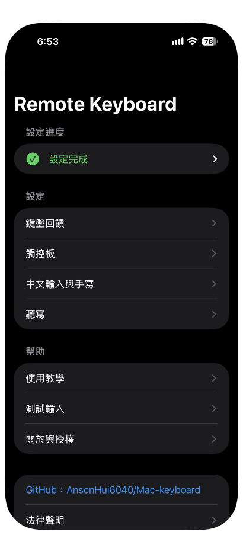
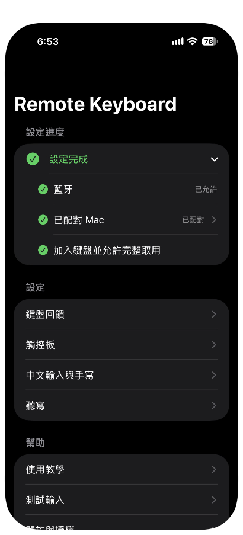
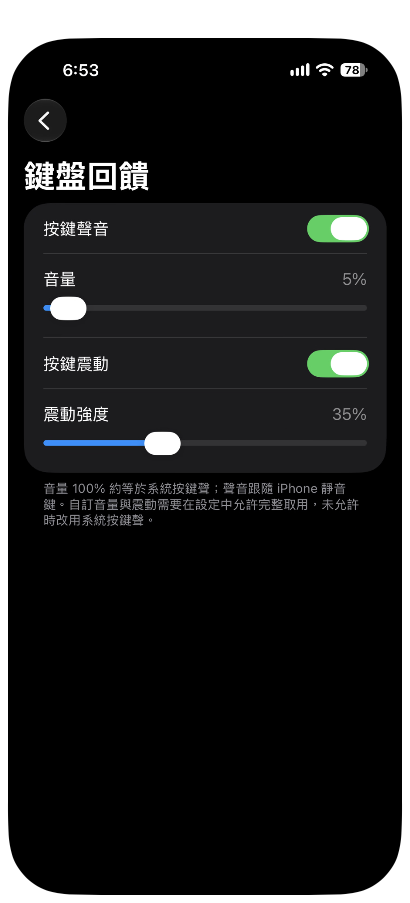
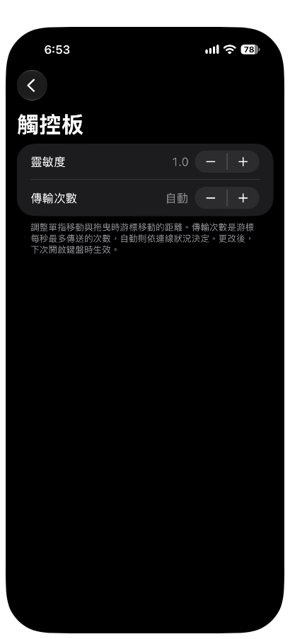
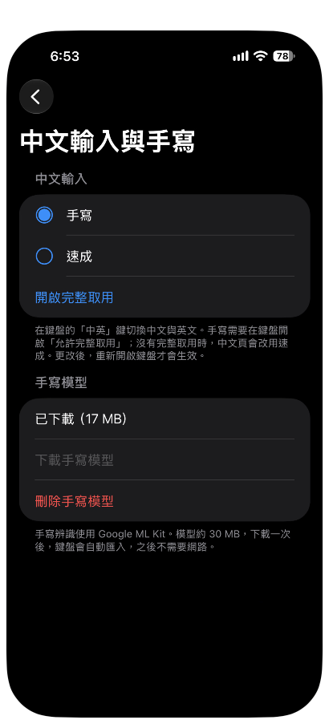
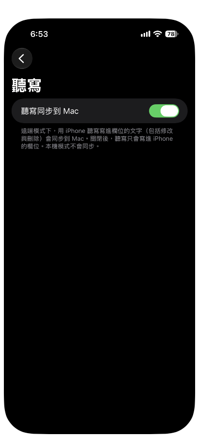
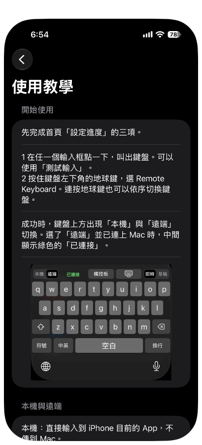

# 08 App settings

All the keyboard's settings are in the Remote Keyboard app on your iPhone.

## Main screen

Open **Remote Keyboard**. The main screen has four sections, from top to bottom.

| Section | Items | Details |
|---|---|---|
| Setup progress (設定進度) | Bluetooth (藍牙), Paired Mac (已配對 Mac), Add the keyboard and Allow Full Access (加入鍵盤並允許完整取用) | When all three are done, they collapse into one line, Setup complete (設定完成). Tap it to expand |
| Settings (設定) | Keyboard feedback (鍵盤回饋), Trackpad (觸控板), Chinese input and handwriting (中文輸入與手寫), Dictation (聽寫) | Each opens its own page, see the sections below |
| Help (幫助) | Tutorial (使用教學), Test input (測試輸入), About and licenses (關於與授權) | See the sections below |
| Bottom | The GitHub link, one copyright line, and the Legal notice (法律聲明) | See "GitHub and the legal notice" |

## Setup progress (設定進度)

Tap Setup complete (設定完成) to expand it and see the three items.

| Item | Details |
|---|---|
| Bluetooth (藍牙) | Tap it to ask for Bluetooth permission. The current status shows on the right. If it shows denied (已拒絕), tap Turn on Bluetooth in Settings (到設定開啟藍牙) |
| Paired Mac (已配對 Mac) | The right side shows Paired (已配對) or Not paired (尚未配對). Tap it to open the pairing page, which has Pair Mac (配對 Mac) and Unpair (解除配對), see [05 Pairing](05-pairing.md) |
| Add the keyboard and Allow Full Access (加入鍵盤並允許完整取用) | Tap it to jump to the Remote Keyboard page in the iPhone Settings app. It only gets a check mark after the keyboard has appeared once with Allow Full Access turned on |

While the items are not all done, the three items are listed directly under Setup progress (設定進度), with the hint: The check mark appears after the keyboard has appeared once. (鍵盤出現過一次後才會打勾。)

If the keyboard could not reach the Mac last time, or pairing verification failed, this section expands by itself and shows Connection problem (連線有問題) with the reason. Tap Pairing verification failed, pair again (配對驗證失敗，請重新配對) to go to the pairing page. Tap The keyboard could not reach the Mac last time (鍵盤上次連不上 Mac) to see a list of things to check. This line disappears by itself the next time the keyboard connects. It also disappears if it has not happened again for more than a day. You never see this hint if you only use Local (本機) mode.

## Keyboard feedback (鍵盤回饋)

On the main screen, under Settings (設定), tap Keyboard feedback (鍵盤回饋).

| Item | Details |
|---|---|
| Key sound (按鍵聲音) | A switch. When on, keys make a sound |
| Volume (音量) | A slider. 100% is about the same as the system keyboard click. The sound follows the iPhone's silent switch |
| Key haptics (按鍵震動) | A switch. When on, keys vibrate |
| Haptic strength (震動強度) | A slider that sets how strong the vibration is |

A custom volume and haptics need Allow Full Access. Without it, the system keyboard click is used instead. While you drag a slider, it plays a preview continuously.

## Trackpad (觸控板)

On the main screen, under Settings (設定), tap Trackpad (觸控板).

| Item | Details |
|---|---|
| Sensitivity (靈敏度) | Adjust it with "+" and "－". It sets how far the cursor moves when you move or drag with one finger |
| Send rate (傳輸次數) | Adjust it with "+" and "－". It is the most times per second the cursor position is sent. When it shows Auto (自動), the app decides based on the connection |

Changes to Sensitivity (靈敏度) and Send rate (傳輸次數) take effect the next time you open the keyboard.

## Chinese input and handwriting (中文輸入與手寫)

On the main screen, under Settings (設定), tap Chinese input and handwriting (中文輸入與手寫).

### Chinese input (中文輸入)

| Item | Details |
|---|---|
| Handwriting (手寫) | The Chinese page uses handwriting |
| Quick (速成) | The Chinese page uses Quick, a simplified form of Cangjie |
| Turn on Full Access (開啟完整取用) | Jumps to Settings, where you turn on Full Access for the keyboard |

The method currently in use has a filled dot in front of it. On the keyboard, use the Chinese/English (中英) key to switch between Chinese and English. Handwriting needs Allow Full Access. Without Full Access, the Chinese page uses Quick (速成) instead. A change takes effect after you reopen the keyboard.

### Handwriting model (手寫模型)

Handwriting recognition uses Google ML Kit. The model is about 30 MB. After one download, the keyboard imports it automatically, and you do not need a network connection afterward.

| Item | Details |
|---|---|
| Status text | Shows Not downloaded (尚未下載), Downloading (下載中) with a percentage, Putting it in the keyboard's shared location... (正在放入鍵盤共用位置…), Downloaded (已下載) with the size, or Failed (失敗) with the reason |
| Download handwriting model (下載手寫模型) | Starts the download. You need an internet connection |
| Delete handwriting model (刪除手寫模型) | Asks Delete handwriting model? (刪除手寫模型？). Tap Delete (刪除) to confirm. After you delete it, the keyboard removes its copy the next time it appears, and you need to download the model again before the handwriting page works |

When you download the handwriting model, ML Kit connects to Google to download the model and sends usage and performance data. For details, see the [privacy note](../../distribution/privacy-note.md) (in Chinese). If you do not want to connect to Google, do not download the handwriting model, and use Quick (速成) or English instead.

When it works, the status text shows Downloaded (已下載) with the size, and the keyboard's handwriting page can recognize your writing.

## Dictation (聽寫)

On the main screen, under Settings (設定), tap Dictation (聽寫).

| Item | Details |
|---|---|
| Sync dictation to Mac (聽寫同步到 Mac) | In Remote (遠端) mode, text that you put into a field with the iPhone's dictation, including edits and deletions, is synced to the Mac. When it is off, dictation only writes into the field on the iPhone. Nothing is synced in Local (本機) mode |

Dictation is handled by iOS, and Apple's dictation privacy terms apply.

## Tutorial (使用教學)

On the main screen, under Help (幫助), tap Tutorial (使用教學).

The tutorial has six parts: Get started (開始使用), Local and Remote (本機與遠端), Live and Draft (即時與草稿), Input methods (輸入方式), Trackpad gestures (觸控板手勢), and Password protection (密碼保護). The See the full manual (看完整手冊) link at the bottom goes to this manual. The first time you open the app, a four-page introduction explains what the app does, how to install the Receiver on the Mac, how to turn on permissions and add the keyboard, and how to pair the Mac. You can skip it.

## Test input (測試輸入)

On the main screen, under Help (幫助), tap Test input (測試輸入). The screen has one text box. Tap it to bring up the keyboard, then touch and hold the globe key and choose Remote Keyboard. You can then try the keyboard inside this app.

## About and licenses (關於與授權)

On the main screen, under Help (幫助), tap About and licenses (關於與授權).

| Item | Details |
|---|---|
| Version (版本) | The build time of this version |
| Licenses (授權) | Lists the link to the terms for handwriting recognition (Google ML Kit), and the license note for the Quick (速成) code table |

## GitHub and the legal notice

At the bottom of the main screen is a link labeled GitHub：AnsonHui6040/Mac-keyboard. Tap it to open the project's GitHub page. The next row, Legal notice (法律聲明), has three blocks of text: a disclaimer, a statement of rights, and third-party notices. The copyright line is at the very bottom. These texts are the same as the Legal notice (法律聲明) at the end of the [project README](../../../README.en.md#legal-notice).

Next chapter: [09 Refresh and update](09-refresh-and-update.md)
