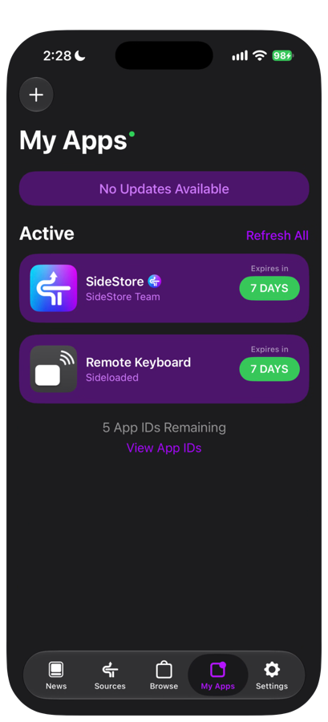

# 09 Refresh and update

An app signed with a free Apple Account is valid for only 7 days. You need to refresh it before it expires, and update it when a new version is out.

## 7-day refresh

1. Open **My Apps** in SideStore and check the expiry dates of Remote Keyboard and SideStore.
2. Before they expire, make sure the iPhone is on Wi-Fi and LocalDevVPN shows Connected (已連線).
3. Tap the day count next to the app (for example, "7 DAYS") to refresh it.
4. Check that the day count has been updated.
5. Open Remote Keyboard and check that it works normally.

When it works, both apps show 7 DAYS again. **Refresh All** at the top right of My Apps refreshes everything at once.

| Note | Details |
|---|---|
| Background refresh | SideStore tries to refresh in the background, but this depends on iOS background execution conditions and does not always succeed |
| Recommendation | Check the expiry dates by hand every 3 to 5 days |
| After it expires | Tapping the app icon does nothing. Connect to Wi-Fi and LocalDevVPN, then refresh. Do not delete the app |

## Update the iPhone app

1. Get the new IPA and check its SHA-256 (see [03 Install the iPhone app](03-install-iphone-app.md) for how).
2. Make sure you are still using the same Apple Account.
3. **Do not delete the old version first.**
4. Connect to Wi-Fi and LocalDevVPN.
5. In SideStore, tap "+" on My Apps and choose the new IPA.
6. When it asks about App Extensions, choose "Keep App Extensions (Register App ID for Each Extension)".
7. Open the app and check that Setup progress (設定進度) shows Setup complete (設定完成), or that the Paired Mac (已配對 Mac) row shows Paired (已配對), so your settings are still there.

When it works, the version string on the main screen has changed, and your pairing and settings are kept.

## Update the Mac Receiver

1. Get the new zip and check its SHA-256 (see [04 Install the Mac Receiver](04-install-mac-receiver.md) for how).
2. Quit the old version: click the keyboard icon in the menu bar, then click Quit (結束).
3. Unzip the new version and drag the app into Applications to replace the old one.
4. The first time you open it, allow it to open as described in [04 Install the Mac Receiver](04-install-mac-receiver.md).
5. Allow Accessibility again. If the switch is already on but the panel still shows Accessibility is not authorized, cannot type text (尚未授權輔助使用，無法輸入文字), remove the app from the list first, then click "+" to add it again.
6. If Bluetooth asks for permission again, allow it.

When it works, the pairing area of the panel still shows iPhone paired (已配對 iPhone), and you do not need to pair again.

## When data can be lost

| Situation | Result |
|---|---|
| You delete the old app and then install again | Pairing and settings are lost |
| You sign with a different Apple Account | It counts as a different app. Pairing and settings are lost, and you must pair again |
| You let the app expire and it gets removed | Data may be lost. Refresh before it expires |

If this happens, pair again by following [05 Pairing](05-pairing.md). You also need to download the handwriting model again in the app (see [08 App settings](08-app-settings.md)).

Next chapter: [10 Troubleshooting](10-troubleshooting.md)
